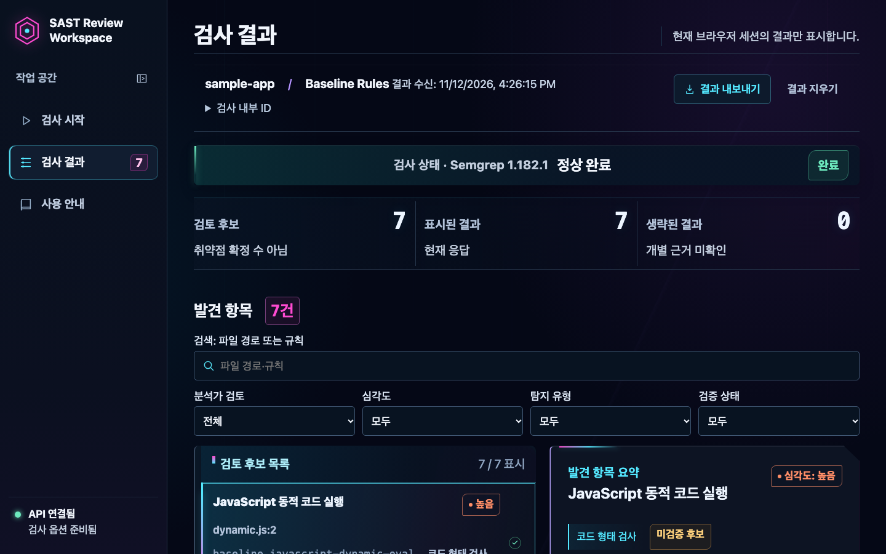
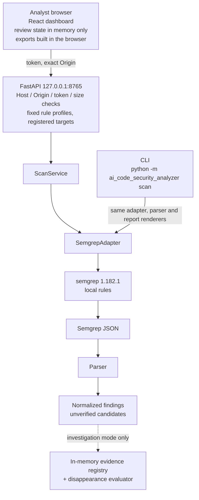

[한국어](README.md) | [English]

# SAST Review Workspace

A local workspace that lets a security analyst **review, annotate, compare across rescans, and export** the static-analysis results of Semgrep OSS. It consists of a Python CLI, a loopback-only FastAPI backend, and a React dashboard.

A static application security testing (SAST) tool reports candidate vulnerabilities. This project covers the step after that: the analyst triages the candidates, records decisions, and checks them against the next scan. Detection itself is done by Semgrep OSS 1.182.1, and every finding is treated as an unverified candidate, not a confirmed vulnerability.

**Status:** in maintenance. Confirmed defects are fixed, and new feature expansion is on hold. Whether the implemented features improve on existing approaches was tested directly, and the results are published under [Validation and research](#validation-and-research).

## Key features

| Feature | What is implemented |
| --- | --- |
| Semgrep result normalization | Converts Semgrep JSON into findings with an ID, severity, and relative location. Reports omit source snippets and raw scanner JSON. |
| Python CLI | `scan` with text, JSON, analyst review, and Markdown output. Report files are created new and never overwritten. |
| FastAPI access control | Binds to `127.0.0.1` only, with a Host allowlist, exact-match Origins, a 43–256 character token, and request and response size limits. Targets are limited to directories registered at startup, and rules to a fixed profile list. |
| React finding review | Filter by severity, detection type, and review status; see triage guidance and the scope of evidence for each finding. |
| Review status and notes | Record a review status and a note per finding, and export or restore them as backup JSON. |
| Rescan comparison | Compares a second scan of the same target and rules by finding ID. A disappeared finding is never marked "fixed". |
| Exports | Markdown report, SARIF 2.1.0, review records, and comparison report, generated in the browser. |
| Partial-scan and error handling | Partial, timed-out, and failed scans and conversion loss are reported as states, not hidden. Incomplete scans are excluded from comparison (`INCOMPARABLE`). |
| Evidence-based disappearance investigation | The `/api/v2` investigation mode records per-run evidence (scan manifest, processed paths, rule-file bytes) and evaluates why a finding was not observed. When evidence is insufficient it answers `UNDETERMINED` and names the missing evidence. |

The baseline rules cover three patterns (dynamic eval, React `dangerouslySetInnerHTML`, Firestore unconditional write), and experimental taint rule profiles can be selected separately. All of the above is covered by tests, and CI runs Python tests, a Semgrep 1.182.1 integration test, and a real Chromium–FastAPI–Semgrep end-to-end test. "Implemented" and "shown to help an analyst" are different claims; the second is addressed under [Validation and research](#validation-and-research).

## Dashboard and architecture



This is the result view of a real scan of the fixtures shipped in the repository (Semgrep 1.182.1). The dashboard text is Korean.



Components and security controls are described in the [project overview](docs/project-overview.md).

## Tech stack

| Area | Technology |
| --- | --- |
| Detection | Semgrep OSS 1.182.1, local YAML rules |
| Backend | Python 3.12, FastAPI, Pydantic, Uvicorn, uv |
| Frontend | React 19, TypeScript, Vite |
| Tests | pytest, Vitest, Playwright |
| CI | GitHub Actions (third-party actions pinned by commit SHA, read-only `contents` permission) |

## Quick start

Requires Python 3.12, [uv](https://docs.astral.sh/uv/), and Semgrep **1.182.1** on `PATH`.

```sh
uv tool install --python 3.12 'semgrep==1.182.1'
uv sync --locked

SAMPLE="$(mktemp -d)"
cp tests/fixtures/security_baseline/positive/* "$SAMPLE"/
uv run --locked python -m ai_code_security_analyzer scan \
  --path "$SAMPLE" --rules rules/security-baseline.yml
```

Expected: `Status: completed` and `Findings: 7 unverified candidate(s)` (5 high, 2 medium). The fixtures are copied first because scanning them in place under `tests/` returns a partial result.

Running the API and dashboard, exports, exit codes, environment variables, and troubleshooting are in [Getting started](docs/getting-started.md).

## Validation and research

After the features were built, four checks tested whether the product actually improves on existing approaches.

| Study | What was tested | Compared against | Result | Decision |
| --- | --- | --- | --- | --- |
| [D1](experiments/d1-finding-disappearance/RESULTS.md) | Does it explain a disappeared finding better? | Semgrep + Git, and a 227-line script that reads `git diff` | On 30 tracked findings the script identified the cause for 30; the product for 15, with 4 wrong. | Stopped expanding the disappearance evaluator and investigation API |
| [D2](experiments/d2-scanner-integrity/RESULTS.md) | Does it catch incomplete scans better? | Default Semgrep, and a 152-line script | Of 13 incomplete scans, default Semgrep missed 11, the script 2, and the product 4 to 8 depending on mode. The product flagged nothing the script missed. | Scan-integrity verdicts dropped as a differentiator |
| [U1](docs/research/u1-appsec-workflow-problem-discovery.md) | Is there public evidence of an unmet workflow problem this project could address? | Public issues, vendor documentation, surveys | None found. Each observed problem is already covered by an existing tool, a setting, or a paid feature. | Stopped searching for further differentiation candidates |
| [U1 closeout](docs/research/u1-closeout-defectdojo-upstream-feasibility.md) | Is an upstream contribution to DefectDojo justified? | DefectDojo 3.5.101 source and related issues and PRs | The related bugs are fixed, and the remaining behavior is a trade-off its maintainers already acknowledge. | No pull request proposed |

On the basis of these four results, new feature expansion was put on hold. No advantage of the product was demonstrated.

Two findings from these experiments hold regardless of this product. Semgrep 1.182.1 with default options exits 0 on most incomplete scans. And comparing findings by location mis-identifies them after a line shift, a rename, or deletion of a duplicate line.

**How far these results go.** The experiments used small, synthetic, author-written cases, and were designed, run, and scored without an independent party. They support "no evidence the product is better", not "a script is always enough". No person was measured and no user was interviewed, so whether the dashboard helps a human analyst is unknown. U1 is a search of public sources, not a survey: it did not show that demand is absent, only that no evidence of demand was found. The [research record](docs/research/README.md) states these limits in full and explains how to recompute the scores. Its detailed records are in Korean.

## Known limitations

| Limitation | Detail |
| --- | --- |
| No AI analysis | No shipped scan path calls a language model. The AI review modules are unconnected research code. |
| One engine, limited rules | Semgrep is the only SAST engine supported, and there is no detection engine of its own. The dynamic-eval rule misses `globalThis.eval`, aliases, and several other forms ([rules README](rules/README.md)). |
| Findings are identified by line and column | Inserting a line or renaming a file changes a finding's ID, so comparison reports it as disappeared and review notes do not carry over. |
| Cannot explain a disappearance | No source snapshot or Git diff is collected, so the investigation mode usually returns `UNDETERMINED`. A finding that disappears is not evidence of a fix. |
| Review state is in browser memory only | It is lost on reload unless exported as backup JSON, and a backup restores only onto an identical set of finding IDs. |
| At most 50 findings per API response | Larger results are truncated and blocked from comparison. |
| No execution sandbox | Semgrep is not isolated from the network or filesystem. An isolated worker exists only as a design. Scan untrusted repositories only inside a separately isolated environment. |
| CI does not pin uv | The workflow passes an input name that `setup-uv` ignores, so the latest uv is installed. |
| Synthetic evaluation only | Real-world precision and recall were never measured. |

The complete list with evidence links is in [Known limitations](docs/known-limitations.md).

## Documentation and project status

- [Documentation index](docs/README.md): where everything is
- [Getting started](docs/getting-started.md): setup, API, dashboard, exports, troubleshooting
- [Project overview](docs/project-overview.md): problem, components, security controls
- [Known limitations](docs/known-limitations.md): the complete list, and what CI checks
- [Research record](docs/research/README.md): D1, D2, U1, how to recompute, why feature expansion was put on hold
- [Baseline rule scope and limits](rules/README.md)

This README, the documentation index, getting started, known limitations, and the project overview are in English. Most other records under `docs/` are written in Korean.

**Project status.** This is a development project in maintenance. Confirmed bugs are fixed and maintenance continues, with security and reproducibility improvements first. New feature expansion needs separate evidence and approval, and multi-engine SAST support is not approved. The D1/D2/U1 research results are preserved as recorded. The project was previously named AI Code Security Analyzer; the Python package (`ai_code_security_analyzer`), the CLI command, the API `service` identifier, and historical records under `docs/` and `experiments/` still use that name.
