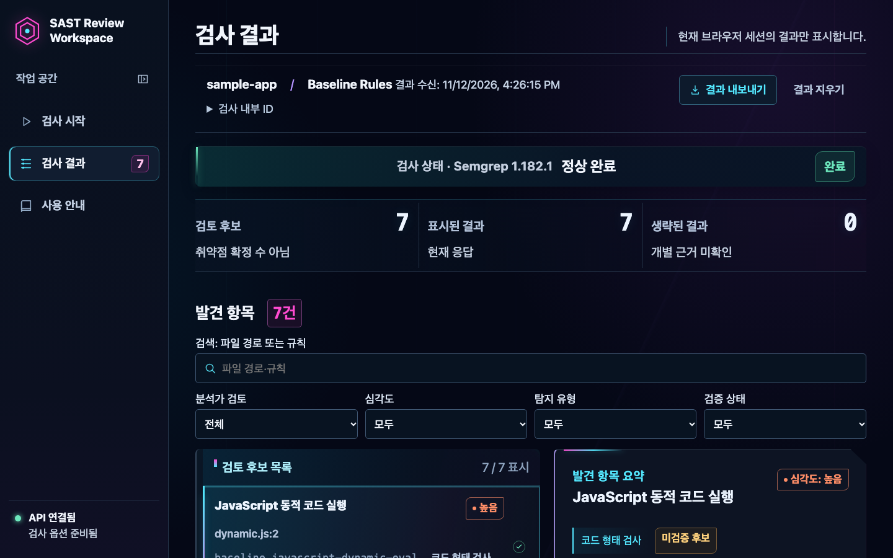
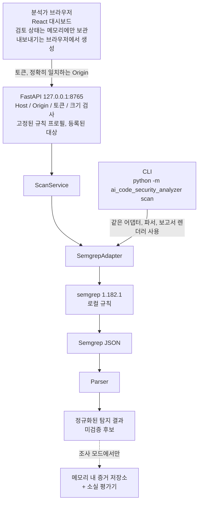

[한국어] | [English](README.en.md)

# SAST Review Workspace

Semgrep OSS의 정적 분석 결과를 보안 분석가가 **검토하고, 기록하고, 재검사 결과와 비교하고, 내보낼 수 있게** 만든 로컬 작업 공간입니다. Python CLI, 로컬 전용 FastAPI 백엔드, React 대시보드로 구성돼 있습니다.

정적 애플리케이션 보안 테스트(SAST) 도구는 취약점 "후보"를 보고합니다. 이 프로젝트는 그 다음 단계, 즉 분석가가 후보를 분류(Triage)하고 판단을 남기고 다음 검사와 대조하는 작업을 다룹니다. 탐지 자체는 Semgrep OSS 1.182.1이 수행하며, 모든 탐지 결과(Finding)는 확정된 취약점이 아닌 미검증 후보로 취급합니다.

**상태:** 유지보수 단계입니다. 확인된 결함은 수정하고, 신규 기능 확장은 보류하고 있습니다. 구현한 기능이 기존 방법보다 나은지 직접 검증했고, 그 결과를 [검증 및 연구](#검증-및-연구)에 공개했습니다.

## 주요 기능

| 기능 | 구현 내용 |
| --- | --- |
| Semgrep 결과 정규화 | Semgrep JSON을 ID, 심각도, 상대 경로 위치를 가진 탐지 결과로 변환합니다. 보고서에는 소스 코드 조각과 원본 스캐너 JSON을 넣지 않습니다. |
| Python CLI | `scan` 명령으로 텍스트, JSON, 분석가 검토, Markdown 형식을 출력합니다. 보고서 파일은 새로 만들기만 하고 덮어쓰지 않습니다. |
| FastAPI 접근 통제 | `127.0.0.1`에만 바인딩하고, Host 허용 목록, 정확히 일치하는 Origin, 43~256자 토큰, 요청·응답 크기 제한을 적용합니다. 검사 대상은 시작할 때 등록한 디렉터리로, 규칙은 고정된 프로필 목록으로 제한합니다. |
| React 탐지 결과 검토 | 심각도, 탐지 유형, 검토 상태로 걸러 보고, 탐지 결과별 검토 가이드와 근거 범위를 확인합니다. |
| 검토 상태와 메모 | 탐지 결과마다 검토 상태와 메모를 남기고, 백업 JSON으로 내보내거나 복원합니다. |
| 재검사 결과 비교 | 같은 대상과 규칙으로 다시 검사한 결과를 탐지 결과 ID로 비교합니다. 사라진 탐지 결과를 "수정됨"으로 표시하지 않습니다. |
| 내보내기 | Markdown 보고서, SARIF 2.1.0, 검토 기록, 비교 보고서를 브라우저에서 생성합니다. |
| 부분 검사와 오류 상태 처리 | 부분 완료, 시간 초과, 실패, 변환 손실을 숨기지 않고 상태로 보고합니다. 불완전한 검사는 비교 대상에서 제외합니다(`INCOMPARABLE`). |
| 증거 기반 소실 조사 | `/api/v2` 조사 모드가 검사별 증거(검사 매니페스트, 처리한 경로, 규칙 파일 바이트)를 기록하고, 탐지 결과가 관찰되지 않은 이유를 평가합니다. 증거가 부족하면 `UNDETERMINED`와 함께 부족한 증거를 명시합니다. |

기본 규칙은 세 가지 패턴(동적 eval, React `dangerouslySetInnerHTML`, Firestore 무조건 쓰기 허용)이며, 실험용 taint 규칙 프로필을 따로 선택할 수 있습니다. 위 기능은 모두 테스트로 검증되고, CI는 Python 테스트, Semgrep 1.182.1 통합 테스트, 실제 Chromium–FastAPI–Semgrep 종단 간 테스트를 실행합니다. 다만 "구현했다"와 "분석가에게 효과가 입증됐다"는 다른 주장이며, 후자는 [검증 및 연구](#검증-및-연구)에서 다룹니다.

## 대시보드와 아키텍처



저장소에 포함된 픽스처를 실제로 검사한 결과 화면입니다(Semgrep 1.182.1).



구성 요소와 보안 통제의 상세 내용은 [기술 개요](docs/project-overview.md)(영어)에 있습니다.

## 기술 스택

| 영역 | 사용 기술 |
| --- | --- |
| 탐지 | Semgrep OSS 1.182.1, 로컬 YAML 규칙 |
| 백엔드 | Python 3.12, FastAPI, Pydantic, Uvicorn, uv |
| 프런트엔드 | React 19, TypeScript, Vite |
| 테스트 | pytest, Vitest, Playwright |
| CI | GitHub Actions (서드파티 액션은 커밋 SHA로 고정, `contents` 읽기 전용 권한) |

## 빠른 실행

Python 3.12, [uv](https://docs.astral.sh/uv/), 그리고 `PATH`에 Semgrep **1.182.1**이 필요합니다.

```sh
uv tool install --python 3.12 'semgrep==1.182.1'
uv sync --locked

SAMPLE="$(mktemp -d)"
cp tests/fixtures/security_baseline/positive/* "$SAMPLE"/
uv run --locked python -m ai_code_security_analyzer scan \
  --path "$SAMPLE" --rules rules/security-baseline.yml
```

기대 결과는 `Status: completed`와 `Findings: 7 unverified candidate(s)`(high 5개, medium 2개)입니다. 픽스처를 먼저 복사하는 이유는 `tests/` 아래에서 그대로 검사하면 부분 결과가 반환되기 때문입니다.

API와 대시보드 실행, 내보내기, 종료 코드, 환경변수, 문제 해결은 [시작하기](docs/getting-started.md)(영어)에 있습니다.

## 검증 및 연구

기능을 구현한 뒤, 이 제품이 기존 방법보다 실제로 나은지를 네 번에 걸쳐 검증했습니다.

| 연구 | 검증하려던 것 | 비교 기준 | 결과 | 결정 |
| --- | --- | --- | --- | --- |
| [D1](experiments/d1-finding-disappearance/RESULTS.md) | 사라진 탐지 결과의 원인을 더 잘 설명하는가 | Semgrep + Git, 그리고 `git diff`를 읽는 227줄 스크립트 | 추적한 탐지 결과 30개 중 스크립트는 30개의 원인을 맞혔고, 제품은 15개를 맞히고 4개를 틀렸습니다. | 소실 평가기와 조사 API 확장을 중단 |
| [D2](experiments/d2-scanner-integrity/RESULTS.md) | 불완전한 검사를 더 잘 잡아내는가 | 기본 옵션의 Semgrep, 152줄 스크립트 | 불완전한 검사 13건 중 기본 Semgrep은 11건, 스크립트는 2건, 제품은 모드에 따라 4~8건을 놓쳤습니다. 스크립트가 놓친 것을 제품이 잡아낸 경우는 없습니다. | 검사 무결성 판정을 차별점으로 삼지 않음 |
| [U1](docs/research/u1-appsec-workflow-problem-discovery.md) | 이 프로젝트가 다룰 수 있는 미해결 실무 문제의 공개 증거가 있는가 | 공개 이슈, 벤더 문서, 설문 자료 | 찾지 못했습니다. 관찰한 문제는 모두 기존 도구, 설정, 또는 유료 기능으로 이미 다뤄지고 있습니다. | 추가 차별화 후보 탐색을 중단 |
| [U1 마무리](docs/research/u1-closeout-defectdojo-upstream-feasibility.md) | DefectDojo에 업스트림 기여를 할 근거가 있는가 | DefectDojo 3.5.101 소스와 관련 이슈·PR | 관련 버그는 이미 수정됐고, 남은 동작은 메인테이너가 이미 인정한 트레이드오프입니다. | PR을 제안하지 않음 |

네 결과를 근거로 신규 기능 확장을 보류했습니다. 제품의 우위는 입증되지 않았습니다.

이 실험에서 나온 두 가지 관찰은 이 제품과 무관하게 성립합니다. 첫째, Semgrep 1.182.1은 기본 옵션에서 대부분의 불완전한 검사에 종료 코드 0을 반환합니다. 둘째, 탐지 결과를 위치로 비교하면 줄이 밀리거나, 파일 이름이 바뀌거나, 중복된 줄이 삭제된 뒤에 탐지 결과를 잘못 식별합니다.

**결과의 적용 범위.** 실험은 작성자가 직접 만든 소규모 합성 사례를 사용했고, 설계·실행·채점에 독립된 제3자가 참여하지 않았습니다. 따라서 이 결과가 뒷받침하는 것은 "제품이 더 낫다는 증거가 없다"이며, "스크립트면 항상 충분하다"가 아닙니다. 사람을 대상으로 측정하거나 사용자를 인터뷰하지 않았으므로, 대시보드가 실제 분석가에게 도움이 되는지는 알 수 없습니다. U1은 공개 자료 검색이지 설문 조사가 아니며, 실무 수요가 없다는 것을 증명한 것이 아니라 수요의 증거를 확보하지 못한 것입니다. 전체 한계와 점수 재계산 방법은 [연구 기록](docs/research/README.md)(영어 색인, 상세 기록은 한국어)에 있습니다.

## 알려진 한계

| 한계 | 설명 |
| --- | --- |
| AI 분석 없음 | 출하된 검사 경로는 언어 모델을 호출하지 않습니다. AI 검토 모듈은 제품에 연결되지 않은 연구 코드입니다. |
| 단일 엔진, 제한된 규칙 | 지원하는 SAST 엔진은 Semgrep 하나이고, 자체 탐지 엔진은 없습니다. 동적 eval 규칙은 `globalThis.eval`, 별칭 등 여러 형태를 놓칩니다([규칙 README](rules/README.md)). |
| 탐지 결과를 줄과 열로 식별 | 줄을 추가하거나 파일 이름을 바꾸면 ID가 달라져, 비교에서 사라진 것으로 보고되고 검토 메모가 이어지지 않습니다. |
| 소실 원인을 설명하지 못함 | 소스 스냅샷이나 Git diff를 수집하지 않아, 조사 모드는 대부분 `UNDETERMINED`를 반환합니다. 탐지 결과가 사라진 것은 수정의 증거가 아닙니다. |
| 검토 상태는 브라우저 메모리에만 존재 | 백업 JSON으로 내보내지 않으면 새로고침할 때 사라지고, 백업은 탐지 결과 ID 집합이 같을 때만 복원됩니다. |
| API 응답당 탐지 결과 최대 50개 | 그보다 많은 결과는 잘리고 비교가 차단됩니다. |
| 실행 샌드박스 없음 | Semgrep을 네트워크나 파일시스템으로부터 격리하지 않습니다. 격리 워커는 설계만 있습니다. 신뢰할 수 없는 저장소는 별도로 격리된 환경에서만 검사하세요. |
| CI가 uv 버전을 고정하지 못함 | 워크플로가 `setup-uv`가 무시하는 입력 이름을 전달해 최신 uv가 설치됩니다. |
| 합성 사례로만 평가 | 실제 저장소에서의 정밀도(Precision)와 재현율(Recall)은 측정한 적이 없습니다. |

근거 링크가 포함된 전체 목록은 [알려진 한계](docs/known-limitations.md)(영어)에 있습니다.

## 문서와 프로젝트 상태

- [문서 색인](docs/README.md): 어떤 문서가 어디에 있는지
- [시작하기](docs/getting-started.md): 설치, API, 대시보드, 내보내기, 문제 해결
- [기술 개요](docs/project-overview.md): 문제 정의, 구성 요소, 보안 통제
- [알려진 한계](docs/known-limitations.md): 전체 목록과 CI가 검사하는 항목
- [연구 기록](docs/research/README.md): D1, D2, U1, 점수 재계산 방법, 기능 확장을 보류한 이유
- [기본 규칙의 범위와 한계](rules/README.md)

문서 색인, 시작하기, 기술 개요, 알려진 한계는 영어이고, `docs/` 아래의 연구 기록과 과거 개발 기록은 대부분 한국어입니다.

**프로젝트 상태.** 유지보수 중인 개발 프로젝트입니다. 확인된 버그 수정과 유지보수를 진행하고, 보안과 재현성 개선을 우선합니다. 신규 기능 확장은 별도의 근거와 승인이 있을 때만 진행하며, 다중 SAST 엔진 지원은 승인되지 않았습니다. D1/D2/U1 연구 결과는 원본 그대로 보존합니다. 이전 이름은 AI Code Security Analyzer이며, Python 패키지(`ai_code_security_analyzer`), CLI 명령, API의 `service` 식별자, 그리고 `docs/`와 `experiments/` 아래의 과거 기록에는 이전 이름이 남아 있습니다.
