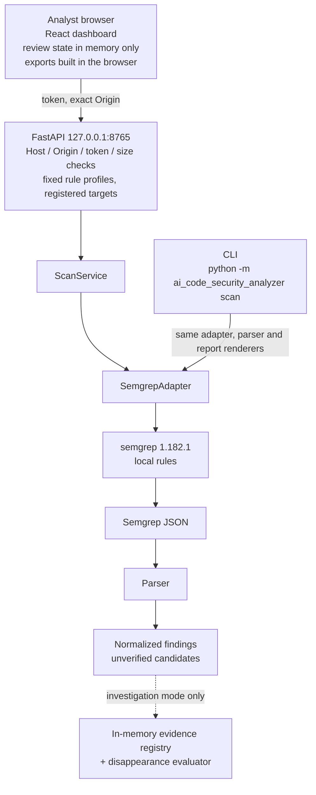

# SAST Review Workspace

A local review workspace built **on top of the Semgrep CLI**: it runs trusted local Semgrep rules on a registered directory, turns the results into unverified candidate findings, and gives an analyst a loopback-only API and React dashboard to triage, compare, and export them.

> **Status: feature development is frozen.** Two experiments and two rounds of research found no evidence that this product improves on Semgrep plus a short script. The code is kept as it is, with known defects documented and not fixed. See [Validation results](#validation-results).

What this project is not:

- **Not an AI analyzer.** No shipped scan path calls a language model. The AI review modules are unconnected research code.
- **Not a detection engine.** All detection is done by Semgrep OSS 1.182.1 with three local rules.
- **Not a multi-engine tool.** Semgrep is the only SAST engine supported. The name describes the kind of results reviewed, not the number of scanners.
- **Not proof of anything.** Every finding is an unverified candidate, and a finding that disappears is not evidence of a fix.

It is a security-engineering portfolio project. Its most useful output is the record of how its own claims were tested and where they failed.

Previously named AI Code Security Analyzer. Because the code is frozen, the Python package (`ai_code_security_analyzer`), the CLI command, the dashboard title, and the headings of exported reports still use that name. Historical records under `docs/` and `experiments/` also keep it.

## What is implemented

| Area | Status | Notes |
| --- | --- | --- |
| CLI `scan` (text, JSON, analyst review, Markdown review) | Implemented | Wraps Semgrep 1.182.1 with trusted local rules |
| Local FastAPI backend (`127.0.0.1:8765`) | Implemented | Token, Host and Origin checks; fixed rule-profile allowlist |
| React dashboard | Implemented | Triage, review status and notes, scan comparison, exports |
| Exports: Markdown, review backup JSON, comparison Markdown, SARIF 2.1.0 | Implemented | Generated in the browser from data already received |
| Finding-disappearance investigation mode (`/api/v2`) | Implemented, bounded | Usually answers `UNDETERMINED`; evidence expires after 15 minutes |
| Baseline rules (`rules/security-baseline.yml`) | Implemented | Dynamic eval, React `dangerouslySetInnerHTML`, Firestore unconditional write |
| Experimental taint rule profiles | Experimental | Selectable in the API and dashboard, labeled experimental |
| AI review modules | Research only | Not called by the CLI, API, or dashboard |
| Isolated Semgrep worker / container sandbox | Design only | No worker is built or executed |

"Implemented" means the feature exists and is covered by tests. It does not mean the feature was shown to help an analyst.

## Architecture



Semgrep runs with local rules, metrics off, and a temporary `HOME`, but with no OS-level sandbox. Scan untrusted repositories only inside a separately isolated environment. Components and security controls are described in the [portfolio overview](docs/portfolio-overview.md).

## Try it

Requires Python 3.12, [uv](https://docs.astral.sh/uv/), and Semgrep **1.182.1** on `PATH`.

```sh
uv tool install --python 3.12 'semgrep==1.182.1'
uv sync --locked

SAMPLE="$(mktemp -d)"
cp tests/fixtures/security_baseline/positive/* "$SAMPLE"/
uv run --locked python -m ai_code_security_analyzer scan \
  --path "$SAMPLE" --rules rules/security-baseline.yml
```

Expected: `Status: completed` and `Findings: 7 unverified candidate(s)` (5 high, 2 medium). The fixtures are copied first because scanning them in place under `tests/` returns a partial result.

The API, dashboard, exports, exit codes, environment variables, and troubleshooting are in [Getting started](docs/getting-started.md).

## Validation results

Four checks looked for a reason to keep building. None found one.

| Study | Question | Result |
| --- | --- | --- |
| [D1](experiments/d1-finding-disappearance/RESULTS.md) | Does the product explain a disappeared finding better than Semgrep + Git? | No. On 30 tracked findings a 227-line script identified the cause for 30, the product for 15, with 4 wrong. |
| [D2](experiments/d2-scanner-integrity/RESULTS.md) | Does the product catch incomplete scans better than existing approaches? | No. Of 13 incomplete scans, default Semgrep missed 11, a 152-line script 2, the product 4 to 8. The product flagged nothing the script missed. |
| [U1](docs/research/u1-appsec-workflow-problem-discovery.md) | Is there public evidence of an unmet workflow problem this project could address? | None found. Each observed problem is already covered by an existing tool, a setting, or a paid feature. |
| [U1 closeout](docs/research/u1-closeout-defectdojo-upstream-feasibility.md) | Is an upstream contribution to DefectDojo justified? | No. The related bugs are fixed and the remaining behavior is a trade-off its maintainers already acknowledge. |

Two findings from these experiments hold regardless of this product. Semgrep 1.182.1 with default options exits 0 on most incomplete scans. And comparing findings by location mis-identifies them after a line shift, a rename, or deletion of a duplicate line.

**How far these results go.** The experiments used small, synthetic, author-written cases, and were designed, run, and scored without an independent party. They support "no evidence the product is better", not "a script is always enough". No person was measured and no user was interviewed, so whether the dashboard helps a human analyst is unknown. U1 is a search of public sources, not a survey. The [research record](docs/research/README.md) states these limits in full and explains how to recompute the scores. Its detailed records are in Korean.

## Main limitations

| Limitation | Detail |
| --- | --- |
| Findings are identified by line and column | Inserting a line or renaming a file changes a finding's ID. Comparison then reports it as disappeared, and review notes do not carry over. |
| Comparison cannot explain a disappearance | No source snapshot or Git diff is collected, so the investigation mode usually returns `UNDETERMINED`. |
| Review state is in browser memory only | Statuses and notes are lost on reload unless exported as backup JSON, and a backup restores only onto an identical set of finding IDs. |
| At most 50 findings per API response | Larger results are truncated and blocked from comparison. Very large Semgrep output is rejected. |
| Known false negatives | The dynamic-eval rule misses `globalThis.eval`, aliases, and several other forms. See the [rules README](rules/README.md). |
| No execution sandbox | Semgrep is not isolated from the network or filesystem. |
| CI does not pin uv | The workflow passes an input name that `setup-uv` ignores, so CI installs the latest uv instead of the intended version. |
| Synthetic evaluation only | Real-world precision and recall were never measured. |

The complete list with evidence links is in [Known limitations](docs/known-limitations.md).

## Documentation

- [Documentation index](docs/README.md): where everything is
- [Getting started](docs/getting-started.md): setup, API, dashboard, exports, troubleshooting
- [Portfolio overview](docs/portfolio-overview.md): problem, components, security controls
- [Known limitations](docs/known-limitations.md): the complete list, and what CI checks
- [Research record](docs/research/README.md): D1, D2, U1, how to recompute, why development stopped
- [Baseline rule scope and limits](rules/README.md)

Most records under `docs/` are written in Korean. This README, the documentation index, getting started, known limitations, and the portfolio overview are in English.
