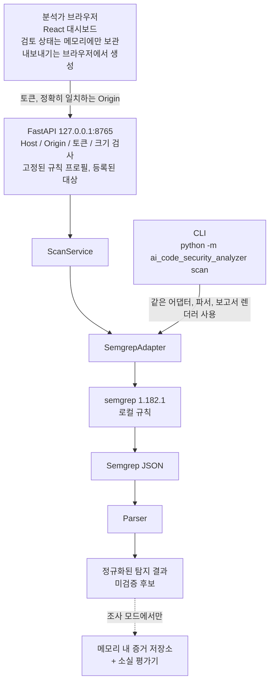

[한국어] | [English](README.en.md)

# SAST Review Workspace

**Semgrep CLI 위에서 동작하는** 로컬 검토 작업 공간입니다. 등록한 디렉터리를 신뢰할 수 있는 로컬 Semgrep 규칙으로 검사하고, 그 결과를 미검증 후보 탐지 결과(Finding)로 정리합니다. 분석가는 로컬 전용 API와 React 대시보드에서 이 결과를 검토(Triage)하고, 재검사 결과와 비교하고, 내보낼 수 있습니다.

> **현재 상태: 기능 개발 동결.** 두 번의 실험과 두 차례의 조사에서, 이 제품이 "Semgrep과 짧은 스크립트" 조합보다 낫다는 증거를 찾지 못했습니다. 코드는 현재 상태로 보존하며, 알려진 결함은 고치지 않고 문서로 남겼습니다. [검증 결과](#검증-결과)를 참고하세요.

이 프로젝트가 아닌 것:

- **AI 분석기가 아닙니다.** 출하된 검사 경로 어디에서도 언어 모델을 호출하지 않습니다. AI 검토 모듈은 제품에 연결되지 않은 연구 코드입니다.
- **탐지 엔진이 아닙니다.** 탐지는 모두 Semgrep OSS 1.182.1과 로컬 규칙 세 개가 수행합니다.
- **다중 엔진 도구가 아닙니다.** 지원하는 정적 애플리케이션 보안 테스트(SAST) 엔진은 Semgrep 하나입니다. 이름의 SAST는 검토 대상 결과의 종류를 뜻하며, 스캐너의 수를 뜻하지 않습니다.
- **무엇도 증명하지 않습니다.** 모든 탐지 결과는 취약점으로 확정되지 않은 미검증 후보입니다. 탐지 결과가 사라졌다는 사실은 취약점이 수정됐다는 증거가 아닙니다.

보안 엔지니어링 포트폴리오 프로젝트입니다. 가장 쓸모 있는 산출물은 이 프로젝트의 주장을 스스로 검증하고, 어디에서 성립하지 않았는지를 남긴 기록입니다.

이전 이름은 AI Code Security Analyzer입니다. 코드가 동결돼 있어 Python 패키지(`ai_code_security_analyzer`), CLI 명령, 대시보드 제목, 내보낸 보고서의 제목에는 이전 이름이 그대로 남아 있습니다. `docs/`와 `experiments/` 아래의 과거 기록도 이전 이름을 유지합니다.

## 구현한 기능

| 영역 | 상태 | 비고 |
| --- | --- | --- |
| CLI `scan` (텍스트, JSON, 분석가 검토, Markdown 검토 출력) | 구현 | 신뢰할 수 있는 로컬 규칙으로 Semgrep 1.182.1을 실행 |
| 로컬 FastAPI 백엔드 (`127.0.0.1:8765`) | 구현 | 토큰, Host, Origin 검사. 규칙 프로필은 고정된 허용 목록에서만 선택 |
| React 대시보드 | 구현 | 검토(Triage), 검토 상태와 메모, 검사 결과 비교, 내보내기 |
| 내보내기: Markdown, 검토 백업 JSON, 비교 Markdown, SARIF 2.1.0 | 구현 | 이미 받은 데이터로 브라우저에서 생성 |
| 탐지 결과 소실 조사 모드 (`/api/v2`) | 구현, 범위 제한 | 대부분 `UNDETERMINED`를 반환. 증거는 15분 뒤 만료 |
| 기본 규칙 (`rules/security-baseline.yml`) | 구현 | 동적 eval, React `dangerouslySetInnerHTML`, Firestore 무조건 쓰기 허용 |
| 실험용 taint 규칙 프로필 | 실험 | API와 대시보드에서 선택 가능하며 실험용으로 표시 |
| AI 검토 모듈 | 연구 전용 | CLI, API, 대시보드 어디에서도 호출하지 않음 |
| 격리된 Semgrep 워커 / 컨테이너 샌드박스 | 설계만 | 워커를 빌드하거나 실행한 적 없음 |

"구현"은 기능이 존재하고 테스트로 검증된다는 뜻입니다. 그 기능이 분석가에게 도움이 된다고 확인됐다는 뜻은 아닙니다.

## 시스템 아키텍처



Semgrep은 로컬 규칙만 사용하고, 사용 통계 전송을 끄고, 임시 `HOME`에서 실행합니다. 그러나 운영체제 수준의 샌드박스는 없습니다. 신뢰할 수 없는 저장소는 별도로 격리된 환경에서만 검사하세요. 구성 요소와 보안 통제는 [포트폴리오 개요](docs/portfolio-overview.md)(영어)에 있습니다.

## 실행 예제

Python 3.12, [uv](https://docs.astral.sh/uv/), 그리고 `PATH`에 Semgrep **1.182.1**이 필요합니다.

```sh
uv tool install --python 3.12 'semgrep==1.182.1'
uv sync --locked

SAMPLE="$(mktemp -d)"
cp tests/fixtures/security_baseline/positive/* "$SAMPLE"/
uv run --locked python -m ai_code_security_analyzer scan \
  --path "$SAMPLE" --rules rules/security-baseline.yml
```

기대 결과는 `Status: completed`와 `Findings: 7 unverified candidate(s)`(high 5개, medium 2개)입니다. 픽스처를 먼저 복사하는 이유는 `tests/` 아래에서 그대로 검사하면 부분 결과가 반환되기 때문입니다.

API, 대시보드, 내보내기, 종료 코드, 환경변수, 문제 해결은 [시작하기](docs/getting-started.md)(영어)에 있습니다.

## 검증 결과

개발을 계속할 근거를 네 번 찾아봤고, 한 번도 찾지 못했습니다.

| 연구 | 질문 | 결과 |
| --- | --- | --- |
| [D1](experiments/d1-finding-disappearance/RESULTS.md) | 사라진 탐지 결과의 원인을 Semgrep + Git보다 잘 설명하는가? | 아니오. 추적한 탐지 결과 30개 중 227줄 스크립트는 30개의 원인을 맞혔고, 제품은 15개를 맞히고 4개를 틀렸습니다. |
| [D2](experiments/d2-scanner-integrity/RESULTS.md) | 불완전한 검사를 기존 방법보다 잘 잡아내는가? | 아니오. 불완전한 검사 13건 중 기본 옵션의 Semgrep은 11건, 152줄 스크립트는 2건, 제품은 모드에 따라 4~8건을 놓쳤습니다. 스크립트가 놓친 것을 제품이 잡아낸 경우는 없습니다. |
| [U1](docs/research/u1-appsec-workflow-problem-discovery.md) | 이 프로젝트가 다룰 수 있는, 해결되지 않은 실무 문제의 공개 증거가 있는가? | 찾지 못했습니다. 관찰한 문제는 모두 기존 도구, 설정, 또는 유료 기능으로 이미 다뤄지고 있습니다. |
| [U1 마무리](docs/research/u1-closeout-defectdojo-upstream-feasibility.md) | DefectDojo에 업스트림 기여를 할 근거가 있는가? | 아니오. 관련 버그는 이미 수정됐고, 남은 동작은 메인테이너가 이미 인정한 트레이드오프입니다. |

이 실험에서 나온 두 가지 관찰은 이 제품과 무관하게 성립합니다. 첫째, Semgrep 1.182.1은 기본 옵션에서 대부분의 불완전한 검사에 종료 코드 0을 반환합니다. 둘째, 탐지 결과를 위치로 비교하면 줄이 밀리거나, 파일 이름이 바뀌거나, 중복된 줄이 삭제된 뒤에 탐지 결과를 잘못 식별합니다.

**이 결과의 적용 범위.** 실험은 작성자가 직접 만든 소규모 합성 사례를 사용했고, 설계·실행·채점에 독립된 제3자가 참여하지 않았습니다. 따라서 이 결과가 뒷받침하는 것은 "제품이 더 낫다는 증거가 없다"이며, "스크립트면 항상 충분하다"가 아닙니다. 사람을 대상으로 측정하지 않았고 사용자 인터뷰도 하지 않았으므로, 대시보드가 실제 분석가에게 도움이 되는지는 알 수 없습니다. U1은 공개 자료 검색이지 설문 조사가 아닙니다. 즉 실무 수요가 없다는 것을 증명한 것이 아니라, 수요의 증거를 확보하지 못한 것입니다. 이 한계의 전체 내용과 점수를 다시 계산하는 방법은 [연구 기록](docs/research/README.md)(영어 색인, 상세 기록은 한국어)에 있습니다.

## 주요 한계

| 한계 | 설명 |
| --- | --- |
| 탐지 결과를 줄과 열로 식별 | 줄을 하나 추가하거나 파일 이름을 바꾸면 탐지 결과의 ID가 달라집니다. 비교 기능은 이를 사라진 것으로 보고하고, 검토 메모도 이어지지 않습니다. |
| 비교 기능은 소실의 원인을 설명하지 못함 | 소스 스냅샷이나 Git diff를 수집하지 않으므로, 조사 모드는 대부분 `UNDETERMINED`를 반환합니다. |
| 검토 상태는 브라우저 메모리에만 존재 | 백업 JSON으로 내보내지 않으면 새로고침할 때 상태와 메모가 사라집니다. 백업은 탐지 결과 ID 집합이 완전히 같은 경우에만 복원됩니다. |
| API 응답당 탐지 결과 최대 50개 | 그보다 많은 결과는 잘리고 비교가 차단됩니다. 매우 큰 Semgrep 출력은 거부됩니다. |
| 알려진 미탐(False Negative) | 동적 eval 규칙은 `globalThis.eval`, 별칭, 그 밖의 여러 형태를 놓칩니다. [규칙 README](rules/README.md)를 참고하세요. |
| 실행 샌드박스 없음 | Semgrep은 네트워크나 파일시스템으로부터 격리되지 않습니다. |
| CI가 uv 버전을 고정하지 못함 | 워크플로가 `setup-uv`가 무시하는 입력 이름을 전달해, 의도한 버전이 아닌 최신 uv가 설치됩니다. |
| 합성 사례로만 평가 | 실제 저장소에서의 정밀도(Precision)와 재현율(Recall)은 측정한 적이 없습니다. |

근거 링크가 포함된 전체 목록은 [알려진 한계](docs/known-limitations.md)(영어)에 있습니다.

## 문서 안내

- [문서 색인](docs/README.md): 어떤 문서가 어디에 있는지
- [시작하기](docs/getting-started.md): 설치, API, 대시보드, 내보내기, 문제 해결
- [포트폴리오 개요](docs/portfolio-overview.md): 문제 정의, 구성 요소, 보안 통제
- [알려진 한계](docs/known-limitations.md): 전체 목록과 CI가 검사하는 항목
- [연구 기록](docs/research/README.md): D1, D2, U1, 점수 재계산 방법, 개발을 멈춘 이유
- [기본 규칙의 범위와 한계](rules/README.md)

위 문서 중 문서 색인, 시작하기, 포트폴리오 개요, 알려진 한계는 영어로 작성돼 있습니다. `docs/` 아래의 연구 기록과 과거 개발 기록은 대부분 한국어입니다.
