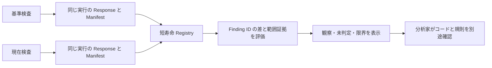

# Finding 消失の調査を支援する

再検査の一覧から Finding が消えても、コード修正、ルール変更、検査対象からの除外のどれが起きたかは一覧だけでは分からない。このプロジェクトは観察された差と証拠不足を分け、分析家が次に確認するものを選べるようにする。

実際の合成ケースでは A/B → A/C の3範疇が各1件となり、消えた B のパスは Semgrep の処理経路として報告された。コード変更の仮説と全体の説明は `UNDETERMINED`。検査者が実験で変更した事実と、分析器が証明できる事実を分ける。[実務ケース](case-studies/finding-disappearance-investigation.md) / [境界ケース](case-studies/investigation-evidence-boundaries.md) / [再現記録](er-d1-reproducibility-record.md)。

設計上の特徴は、厳密な Finding ID の集合比較、同一実行の Response/Manifest の内部結合、短命の証拠と明示的 Release、Semgrep の処理・除外観察と不十分な証拠の区別、公開 API における固定コードと最小化された出力である。類似 OSS との網羅比較を実施しておらず、排他的な優位性は主張しない。

ER-C3E/F の自動テストでは実 FastAPI–Semgrep–Chromium、API 境界、Registry、WebKit 等を検証し、ER-C3G ではユーザー報告に基づく Safari の核心フローを受け付けた。Safari 試験時の実行 SHA は独立検証されていない。[受容記録](er-c3g-safari-core-user-acceptance-final.md)。

制限: baseline 規則の対象範囲、一般ソース snapshot 未収集、実ロード規則の identity 未検証、単一 worker、ユーザー別隔離なし、15分 TTL、永続保存なし、ハード RSS 上限なし、運用承認なし。コード修正・解決や実際の悪用可能性を自動的に確定しない。
