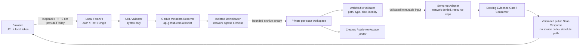

# Phase 7B — GitHub 저장소 수집 위협 모델 및 아키텍처

## 판정 및 범위

- 프로젝트: `ai-code-security-analyzer`
- 기준 커밋: `175afefcb05a3d8d9e862584f0cc4c82455faa4c`
- 기준 GitHub Actions: Run `40917235294`, `push / completed / success`
- 시작 Gate: 통과. 로컬 `main`, `origin/main`, GitHub `main`이 모두 기준 SHA였고 working tree clean, ahead/behind `0/0`이었다. Python/CLI, Semgrep 1.182.1, React dashboard, Chromium smoke 및 실제 Chromium–FastAPI–Semgrep E2E job의 필수 단계가 성공했다.
- 판정: **`PHASE_7B_GITHUB_INTAKE_DESIGN_READY`**
- 의미: 설계와 구현 전제조건이 구체화되었다는 뜻이다. 외부 저장소를 현재 환경에서 안전하게 분석할 운영 승인이 아니며, 아래 차단 조건이 충족될 때까지 구현·사용을 시작해서는 안 된다.
- 변경 범위: 이 문서만 변경한다. 다운로드, clone, API, UI, 엔진 및 규칙은 변경하지 않았다. 실제 공격 테스트와 전체 회귀는 수행하지 않았다.

## 1. 현재 구현 상태

### 이미 구현된 통제

Phase 7A 코드에서 확인한 사실:

- API 실행 진입점은 `127.0.0.1:8765`에 bind한다.
- `/api/v1/scans`는 `X-Local-API-Token` 인증, Host/Origin 경계와 요청 크기 제한을 통과해야 한다. 등록된 target ID와 allowlist의 rule profile만 받는다.
- `AI_CODE_SECURITY_TARGETS`로 운영자가 최대 32개 프로젝트를 등록할 수 있고, 기존 `AI_CODE_SECURITY_TARGET` 단일 설정도 유지한다. Options 응답은 ID와 label만 반환한다.
- 등록·검사 직전 경로 검증은 symlink 구성요소, 규칙 디렉터리와의 중첩, 프로젝트 내부 symlink, 항목 수/사전 검사 시간 한도, `(st_dev, st_ino)` 교체 여부를 검사한다. 코드 주석도 동시 파일시스템 변경을 완전히 막지 못한다고 명시한다.
- API scan은 single-flight lock을 사용한다. Semgrep 실행은 OSS 전용, 신뢰된 로컬 규칙, timeout 60초, stdout/stderr 합계 2,000,000바이트 상한을 가진다.
- 응답 DTO는 상대 경로만 허용하고 Finding은 `unverified`로 유지한다. Evidence Gate와 Consumer가 지원 가능한 claim만 허용한다. API의 현재 입력은 `target_id`와 `rule_profile_id`뿐이며 저장소 URL·출처·commit 필드는 없다.
- 코드 원문, Semgrep raw JSON/stderr, 서버 절대 경로는 공개 DTO에 포함하지 않는다.

### 현재 구현이 보장하지 않는 것

- GitHub URL 입력 검증, 공개 저장소 판별, GitHub API 호출, archive 다운로드, redirect 검사, SSRF 방어는 구현되어 있지 않다.
- OS sandbox, 전용 네트워크 namespace/egress deny, CPU·메모리·디스크 quota, 임시 저장소 자동 정리는 구현되어 있지 않다.
- Semgrep은 별도 네트워크 격리 없이 API 서버의 실행 환경에서 subprocess로 시작된다. 현재 실행 제한은 프로세스 timeout/output 한도이지 OS 권한 격리가 아니다.
- 로컬 target의 `(device, inode)` 확인은 특정 디렉터리 교체를 탐지하는 방어층이다. 저장소 전체의 snapshot이나 TOCTOU 제거를 보장하지 않는다.

따라서 공개 GitHub 저장소는 현재 허용된 로컬 프로젝트와 다른 신뢰 수준이다. 사용자 URL을 기존 `target_id`로 취급하거나 현재 API 경계만으로 원격 수집이 안전하다고 볼 수 없다.

## 2. 범위, 공격자 및 보호 자산

### MVP 지원 범위 제안

- 공개 GitHub.com 저장소만 허용한다.
- 유일한 입력 문법은 `https://github.com/OWNER/REPO`이다. 선택적으로 마지막 경로 요소의 `.git` 접미사를 허용하고 내부 식별자에는 제거한 이름을 쓴다. 그 외 경로, ref, 파일 경로, query, fragment, 포트, 사용자정보는 허용하지 않는다.
- `http`, `ssh`, `git`, `file`, GitHub Enterprise, 비 GitHub 호스트, private 저장소, 사용자 지정 archive/download URL, submodule 및 Git LFS 자동 수집은 거부한다.
- branch/tag를 입력으로 받지 않는다. 서버가 GitHub API에서 기본 branch와 그 시점의 commit SHA를 조회한 후, 실제 다운로드 전에 commit SHA를 고정한다. 사용자는 결과에 표시된 commit을 검토한다.
- 사용자가 나중에 특정 commit을 지정할 기능은 별도 검토 대상이다. MVP에서는 URL path에 임의 ref를 허용하지 않는다.

### 입력 문법과 정규화

URL은 표준 URL parser로 parse하고 결과 필드를 개별 검증한다. `startswith("https://github.com")` 같은 prefix 검사는 사용하지 않는다.

1. 스킴은 정확히 `https`; hostname은 ASCII case-insensitive 비교 후 정확히 `github.com`이어야 한다. 후행 점, IDN/Unicode hostname, IP literal, userinfo, password, non-default port는 거부한다.
2. 허용 path는 `/OWNER/REPO` 또는 `/OWNER/REPO.git`뿐이다. 선행/중복 slash, 빈 segment, `.`/`..`, percent escape, backslash, encoded slash/backslash, 제어문자, query와 fragment는 거부한다. parser가 정규화 전에 escape를 풀지 않도록 raw authority/path도 검사한다.
3. MVP는 GitHub.com의 전체 이름 가능 범위보다 좁은 ASCII subset을 고정한다. Owner: `[A-Za-z0-9](?:[A-Za-z0-9-]{0,37}[A-Za-z0-9])?`, 길이 1–39, `--` 포함 거부. Repository: `[A-Za-z0-9](?:[A-Za-z0-9._-]{0,98}[A-Za-z0-9])?`, 길이 1–100, `..` 포함 및 끝의 `.` 거부. 이 subset은 맨 앞/뒤 구분자와 혼동을 거부하며 유효한 GitHub 이름 일부를 의도적으로 거절할 수 있다. `.git` 접미사는 정확히 한 번 허용하고 떼어낸 repo가 위 규칙을 통과해야 하며 `.git`으로 끝나는 정규화 repo 이름도 거부한다. 따라서 실제 이름이 문자 그대로 `.git`으로 끝나는 저장소는 MVP에서 구별 불가로 거부한다. 구현 전 공식 명명 규칙과 fixture로 정규식을 확인한다. 이름 대소문자는 API 식별에 보존하되 안전 표시용 canonical key는 ASCII casefold를 적용한다. [GitHub username policy](https://docs.github.com/en/site-policy/other-site-policies/github-username-policy), [repository name rules](https://docs.github.com/en/repositories/creating-and-managing-repositories/creating-a-new-repository#about-repository-creation)
4. 표시용 식별자는 `github.com/{owner}/{repo}`로 제한한다. query, fragment, 사용자명/토큰, redirect URL은 로그·응답·Markdown에 남기지 않는다.
5. URL 검증은 입력 형식 정책일 뿐 실제 연결 대상 제한이 아니다. DNS 결과, redirect와 socket peer 검증은 별도 필수 통제다.

## 3. 데이터 자산 및 신뢰 경계

보호할 자산: API 토큰, 사용자/조직의 로컬 프로젝트와 파일, 내려받은 저장소 코드, 분석 규칙, 분석 결과, 로컬 파일시스템, 사용자 환경의 네트워크 및 credential, 상대 저장소 간 결과 분리.

공격자는 임의 공개 저장소의 소유자 또는 커밋 작성자일 수 있고 악의적 파일명, 경로, symlink, 압축 메타데이터와 parser 입력을 만들 수 있다. 네트워크 경로에 DNS/redirect 제어가 개입할 수 있다. 로컬 비관리 브라우저 사용자는 인증 토큰이 없거나 제한된 사용 권한만 가진다. 로컬 OS 관리자 및 API 서버와 동일 권한을 가진 공격자는 이 MVP 위협 모델의 격리 보장 범위 밖이다.

**현 상태와 설계의 차이:** loopback FastAPI, 토큰 및 현재 로컬 scan 흐름은 있다. 별도 Metadata Resolver, Downloader, archive validator, private per-scan workspace, 네트워크 차단 분석 worker, remote provenance DTO는 없다. 다이어그램의 `HTTPS`는 미래 설계이며 현재 localhost API는 TLS가 아니다.

## 4. SSRF 및 네트워크 공격 통제

### 필수 통제

- Browser 요청은 저장소 URL만 전달한다. 입력 URL에 직접 요청하지 않고 서버가 검증된 owner/repo를 사용해 고정된 `api.github.com` API 경로를 만든다. 사용자 입력이 HTTP method, header, proxy, 다운로드 URL을 정하지 못한다.
- HTTP client 자동 redirect는 끈다. 각 redirect를 수동으로 처리하고 hop 수(제안: 최대 3), scheme, 정확한 host, port, userinfo, path 형식을 재검증한다. archive 302가 허용 정책의 host로 이동하지 않으면 거부한다. Redirect 시 `Authorization`, Cookie 및 내부 헤더를 다른 origin에 전달하지 않는다.
- 요청 직전 DNS A/AAAA를 조회하고 모든 응답 주소가 public routable이며 허용 정책에 맞는지 확인한다. 실제 연결은 검사된 주소에 고정(pin)하고 TLS SNI/인증서 hostname은 원래 허용된 hostname으로 검증한다. 연결 후 socket peer 주소도 확인한다. DNS를 검사한 뒤 HTTP client가 다시 해석하게 두는 방식은 rebinding을 막지 못한다.
- IPv4/IPv6 loopback, private, link-local, unspecified, multicast, documentation, reserved, IPv4-mapped IPv6, cloud metadata 주소를 거부한다. 운영체제 proxy 환경변수를 무시하고 proxy 사용을 기본 비활성화한다. 외부 egress firewall은 애플리케이션 검사와 독립적으로 적용한다.
- `api.github.com`은 metadata와 archive redirect 응답을 받는 용도로만 허용한다. 공개 archive endpoint의 실제 redirect 목적지는 공식 동작을 고정 테스트로 확인한 뒤 exact host allowlist에 넣는다. 설계 후보는 `codeload.github.com`이지만 이 호스트를 허용한다는 사실만으로 실제 연결 peer 안전성이 증명되지는 않는다. 예기치 않은 CDN/host 변경은 자동 허용하지 않고 실패 처리한다.
- 각 hop의 TLS 검증, 연결/읽기 timeout, 전체 deadline, redirect count, response byte 수를 강제한다. HTTP 오류 body와 `Location` 전체를 오류/로그에 복사하지 않는다.

GitHub 공식 문서는 archive endpoint가 `302`를 반환하고 client가 redirect를 따라가거나 `Location`으로 두 번째 GET을 해야 한다고 설명한다. 따라서 URL hostname 한 번만 확인하는 설계는 충분하지 않다. [GitHub archive API](https://docs.github.com/en/rest/repos/contents#download-a-repository-archive-tar)

URL encoding, `github.com.attacker.example`, `github.com@127.0.0.1`, Unicode/IDN, dot-segment, IPv6 literal, DNS rebinding, redirect-chain은 모두 reject-by-default로 테스트한다. URL 검증과 network egress 제한을 서로 대체 가능한 방어로 설명하지 않는다.

## 5. 수집 방식 비교 및 결정

| 기준 | A. 제한된 Git Clone | B. GitHub API + archive |
|---|---|---|
| 네트워크 목적지 | Git transport와 redirect/credential helper의 영향 통제 필요 | 고정 API endpoint와 제한 redirect를 명시적으로 통제 가능 |
| commit 고정 | SHA fetch 후 checkout 정책 필요. clone 기본 동작은 remote-tracking refs와 초기 checkout을 만든다 | metadata로 immutable SHA를 먼저 고정하고 해당 SHA archive를 받음. archive와 tree 동일성 검증 추가 필요 |
| 코드 실행/설정 | Git 설정, credential helper, hooks, filter, LFS, submodule 및 checkout 경로를 통제해야 함 | Git executable 불필요. 압축 parser와 archive path/type 검증은 필요 |
| 자격증명 | 사용자 전역 설정/credential helper 환경을 차단해야 함 | 공개 API는 비인증 가능. MVP는 credential을 전혀 받지 않음 |
| 경로 및 자원 경계 | checkout 이후 파일시스템 결과 검증 필요 | 압축 해제 전 entry 검증과 bounded extraction 필요 |
| 복잡도/이식성 | Git 버전, config 및 플랫폼 동작을 격리해야 함 | HTTP, API rate limit, redirect 및 archive 형식 처리 필요. 플랫폼에 덜 의존 |
| 권고 | MVP에서는 채택하지 않음 | **MVP 후보로 채택. 단, 격리 전제 미충족 시 구현 보류** |

Git 공식 문서는 clone이 기본적으로 초기 branch checkout을 수행하며 `--no-checkout`이 이를 생략한다고 설명한다. Git hooks는 특정 작업에서 실행되는 프로그램이고 clone 후 checkout 시 `post-checkout` hook도 호출될 수 있다. Clone을 단순 데이터 복사로 취급하지 않는다. [git-clone](https://git-scm.com/docs/git-clone), [githooks](https://git-scm.com/docs/githooks)

향후 별도 비교에서 clone이 필요하다고 판정되더라도 API 프로세스 내 일반 `git clone`은 금지한다. 최소한 network-isolated disposable worker, 임시 `HOME`/XDG config, `GIT_CONFIG_NOSYSTEM=1`, `GIT_TERMINAL_PROMPT=0`, credential helper 비활성화, hooks 경로 무효화, LFS/filter/submodule 금지, shell/환경변수 정리, SHA 고정 및 checkout 이후 파일 검증이 필요하다. 이는 권고 설정 목록이지 그 자체로 sandbox 증거는 아니다.

GitHub API 비인증 요청의 기본 REST limit은 현재 문서상 IP 기준 시간당 60회다. 제한 헤더와 `403/429`를 안전하게 처리하고 재시도 폭주를 막아야 한다. rate limit은 배포·사용자 네트워크에 따라 바뀔 수 있으므로 문서화된 수치에만 의존하지 않는다. [GitHub REST rate limits](https://docs.github.com/en/rest/using-the-rest-api/rate-limits-for-the-rest-api)

## 6. 커밋 동일성 및 출처 신뢰

1. API는 repository endpoint에서 공개 여부와 기본 branch를 확인하고 그 branch의 commit SHA를 resolve한다. 저장소가 private/없음/비어 있음/권한 또는 rate limit 오류인 상태를 서로 추측해 구분하지 않는다. 외부 응답은 고정 오류 범주로 정규화한다.
2. SHA 형식과 길이를 API 응답 스키마로 확인하고 commit endpoint가 같은 SHA를 반환하는지 확인한다. 이후 branch 이름은 사용하지 않고 immutable SHA만 archive resolver에 넘긴다. branch가 그 뒤 이동해도 고정 commit을 바꾸지 않는다.
3. archive 다운로드 파일을 임시 보관하고, 추출 전 크기·형식·checksum 및 gzip/tar 무결성을 확인한다. API의 commit/tree 객체를 같은 SHA에서 조회해 path/mode/type/size/blob SHA manifest를 만든다. Git Trees 응답의 `truncated=true`이면 manifest가 불완전하므로 fail closed한다. [Git Trees API](https://docs.github.com/en/rest/git/trees)
4. 안전한 경로만 추출한 뒤 파일 목록이 tree manifest와 정확히 일치하는지 확인한다. 모든 regular blob의 내용에 대해 Git blob object digest를 해당 tree blob ID와 비교한다. 이 설계는 지원되는 Git object hash 형식을 명시적으로 확인해야 한다. 구현에서 archive 파일과 tree의 전체 path/mode/blob ID를 대조하지 못하면 commit 동일성은 `NOT_VERIFIED`이며 scan을 완료 결과로 제공하지 않는다.
5. symlink, submodule gitlink, LFS pointer 또는 지원하지 않는 mode/object가 포함되면 MVP는 해당 저장소를 거부한다. “tree manifest와 같은 commit snapshot”은 서명자나 코드의 신뢰성 검증이 아니다.
6. 다운로드 후 Semgrep 시작 직전에도 manifest/content digest를 재검증하고, workspace를 downloader와 analyzer 사이에서 쓰기 불가로 전환한다. 검증 후 수정/불일치가 발견되면 분석을 중지하고 결과를 폐기한다.

GitHub Trees API는 재귀 tree 응답이 최대 100,000개 항목/7 MB 한도를 넘으면 `truncated`를 표시할 수 있다고 명시한다. 이 값을 무시하고 부분 tree를 완전한 출처 manifest로 간주하지 않는다. [Git Trees API](https://docs.github.com/en/rest/git/trees)

기존 Finding ID는 `[rule_id, relative_path, start/end location]`의 SHA-256 일부로 계산되며 repository/commit을 포함하지 않는다. 공개 식별을 위해 기존 ID 계산을 바꾸지 않는다. Future API v2는 scan/job ID와 provenance 객체 안에 repository canonical ID 및 commit SHA를 두어 result scope를 분리한다. Finding ID 단독으로 여러 저장소 간 동일성/출처를 주장하지 않는다.

## 7. 임시 workspace와 파일 검증

### 제안 수명

- 전용 OS 계정 또는 disposable worker에서 `mkdtemp`에 준하는 원자적 생성, owner-only 디렉터리(0700)와 파일(0600)을 사용한다. 다운로드 디렉터리와 검증 완료 workspace는 분리한다.
- Workspace는 scan/job별 난수 ID로 분리한다. repository 코드의 파일 mode/권한은 재현하지 않고 새 regular files로 쓴다. Analyzer가 읽을 때만 읽기 전용으로 mount/권한 설정하고, downloader와 같은 writable namespace를 공유하지 않는다.
- 정상 완료, download/validation/scan 오류, timeout, cancellation 모두 `finally` cleanup을 시도한다. 정리 실패는 경로를 노출하지 않는 고정 issue로 기록한다.
- 서버 시작 시 본 서비스가 만든 prefix의 오래된 디렉터리만 owner, type, 생성 시각, symlink-free 조건을 확인해 정리한다. 임의 temp 파일을 탐색/삭제하지 않는다. 제안 TTL 24시간; 최대 보존 기간 보장은 아니다.
- 강제 종료·전원 손실 뒤 잔존 파일이 생길 수 있다. 기동 시 janitor 및 OS temp cleanup은 best effort다. APFS/SSD/copy-on-write 환경에서 unlink가 물리적 secure erase를 의미하지 않으므로 삭제 보장을 하지 않는다.

### Archive 검증

Tar.gz를 MVP 포맷으로 한정하고 일반적인 범용 추출 라이브러리의 `extractall`을 바로 사용하지 않는다. Header를 순차 확인하고 안전한 새 파일만 생성한다.

- 저장소 archive root 아래의 단일 prefix를 제거하되 정확히 하나인지 확인한다. absolute path, `..`, 빈/dot segment, NUL, backslash, drive/UNC 경로, percent/Unicode confusable, 허용되지 않은 제어문자를 거부한다.
- NFC 정규화 후 서로 다른 원래 경로가 같은 이름이 되거나 casefold 충돌하는 경로, 중복 항목, 파일/디렉터리 prefix 충돌을 거부한다. Linux와 기본 macOS filesystem 차이로 overwrite/alias가 생기지 않도록 conservative cross-platform 규칙을 적용한다.
- symlink, hardlink, device, FIFO, socket, sparse/unknown entry, submodule 및 특수 mode를 거부한다. entry는 regular file 또는 directory만 허용한다.
- 압축 데이터와 확장 데이터의 byte 수, 파일 수, 깊이, 개별 파일 크기, 경로 byte 길이, 전체 deadline을 스트리밍 중 강제한다. 선언된 archive size를 신뢰하지 않는다. 압축비 폭탄 및 trailing concatenated stream을 거부한다.
- 대상 경로는 새 private root 아래에서 `openat`/directory descriptor 상대 생성과 no-follow/exclusive flag를 활용한다. 플랫폼에서 동등한 no-follow 안전 생성을 보장하지 못하면 extraction을 지원하지 않는다. `lstat` 사전 검사만으로 race를 막았다고 보지 않는다.
- mode-bit에 실행 권한을 복원하지 않는다. 파일 이름 및 source contents는 로그·API에 쓰지 않는다.

### 제안 초기 제한값

아래는 **구현 전 검증해야 하는 설계 예산**이지 현재 제품 한도나 검증된 안전값이 아니다. 7C의 정량 테스트에서 OS별 peak memory/disk/time을 재고, 초과 시 조정 승인 기록을 남긴다.

| 자원 | 제안 상한 | 초과 시 동작 |
|---|---:|---|
| Redirect hop | 3 | 수집 실패 |
| Metadata API 호출 | scan당 10 | 수집 실패, 자동 재시도 없음 |
| Archive 전송 크기 | 50 MiB | stream 취소 및 workspace 정리 |
| 압축 해제 파일 데이터 합계 | 250 MiB | 추출 중지 및 정리 |
| Regular file 수 | 20,000 | 추출 중지 |
| 최대 깊이 | 32 segment | 해당 archive 거부 |
| 단일 파일 | 5 MiB | 해당 archive 거부 |
| Path 길이 | UTF-8 1,024 byte | 해당 archive 거부 |
| 다운로드 전체 deadline | 120초 | 연결 취소·정리 |
| Semgrep scan | 기존 60초 | 프로세스 종료·정리 |
| Semgrep stdout+stderr | 기존 2,000,000 byte | 프로세스 종료·정리 |
| 분석 동시성 | 전체 1개로 시작 | 추가 scan은 기존 busy 정책에 맞게 거부 |
| Workspace 디스크 quota | 512 MiB/scan | write 실패 시 즉시 중단·정리 |
| Analyzer | 제안 2 CPU, 1 GiB RAM | cgroup/container limit 초과 시 작업 실패 |

CPU/RAM/disk quota를 플랫폼에서 실제 강제할 수 없는 실행 경로는 비신뢰 원격 저장소 분석을 지원하지 않는다. Python 카운터와 timeout만으로 OS 자원 격리가 된다고 보지 않는다.

## 8. 네트워크 및 실행 격리 요구사항

- **Downloader**는 metadata/archive host만 egress할 수 있는 별도 worker로 분리한다. Browser/API request가 임의 네트워크 연결을 만들 수 없어야 한다.
- **Analyzer**는 별도 프로세스/container/VM에서 network namespace 또는 동등한 OS 정책으로 outbound 및 inbound 네트워크가 차단되어야 한다. GitHub DNS/API 및 proxy 환경변수도 차단한다.
- API 서버는 workspace 조정자이며, 다운로드된 파일을 실행하지 않는다. Semgrep rule은 trusted local bundle only. 기존 Semgrep 옵션, timeout, output limit 유지.
- Temp volume은 전용 경로와 quota가 있어야 하며 다른 job과 공유하지 않는다. Analyzer에 최소 read access, 결과/metadata output directory에만 제한 write 권한을 준다.
- macOS 개발 환경은 기본 macOS 사용자 프로세스가 네트워크/파일시스템 namespace 격리됐다고 볼 수 없다. Docker Desktop/VM을 사용하는 경우 host mount 범위, network mode, daemon 권한, resource limit을 실제 검증해야 한다. 충족하지 않으면 synthetic fixtures로만 개발한다.
- Ubuntu CI에서는 ephemeral runner/container, unprivileged UID, read-only root filesystem, no network namespace/egress deny, seccomp/AppArmor 또는 동등 제한, cgroup CPU/RAM/pids/disk quota를 적용할 수 있는지 pipeline에서 검증한다. CI가 external fetch에 접근하지 못하게 하면서 GitHub archive fetch 테스트가 필요한 경우 network fixture/proxy sandbox로 나누어 테스트한다.
- 현재 서비스가 위 분리를 제공하지 않으므로 7C 구현 시작 차단 조건으로 둔다. 환경 제한이 불명확한 상태에서 외부 공개 저장소를 실제 scan하지 않는다.

## 9. API/UI 통합 방향

### API

- 기존 `/api/v1/options`, `/api/v1/scans`, `target_id` 및 로컬 target 정책을 변경하거나 GitHub URL을 `target_id`에 끼워 넣지 않는다.
- 권고는 별도 versioned remote scan API, 예: `/api/v2/scans`, 또는 v1 유지와 별도 `/api/v1/github-scans` 중 하나를 API compatibility review 후 선택하는 것이다. Request는 URL 문자열만 받고 archive URL/path나 filesystem path는 받지 않는다.
- 7D에서 request/response schema version을 고정한다. 새로운 ScanContext에는 `source_kind`, safe repository ID, immutable `commit_sha`, `content_identity_status`, scan state를 포함한다. URL의 raw credential/query는 절대 보관하지 않는다.
- API 오류는 고정된 코드만 반환: invalid URL, unsupported source, not public/unavailable(존재 여부 추측 방지 고려), rate limited, download limit, archive rejected, commit identity unverified, scan timeout, cleanup failed. 응답에 HTTP body, absolute temp path, source text, redirect URL을 포함하지 않는다.
- partial/failed 상태를 기존 finding 수와 혼동하지 않는다. commit identity 검증 실패는 정상 completed scan으로 응답하지 않는다.

### UI 및 기존 로컬 흐름

- Local Project와 GitHub Repository는 별도 입력 탭/타입으로 보여준다. 로컬 target은 운영자가 신뢰 설정에 등록한 프로젝트, GitHub는 외부 비신뢰 snapshot이라는 출처·격리 차이를 안내한다.
- GitHub URL 입력, 지원 범위, privacy 안내, 수집/검증/분석/정리 상태를 별도로 표시한다. 검증되지 않은 source commit은 “commit 고정 미검증”으로, 실패 원인은 API가 제공한 고정 코드 이상의 추측 없이 표시한다.
- 결과 export는 repository canonical ID와 commit SHA를 context에 고정하고 절대 경로·원본 URL query·토큰·코드를 제외한다.
- UI는 현재 API/DTO를 바꾸지 않고 후속 버전 schema 구현과 동시에 진행한다.

## 10. 테스트 매트릭스

| 위협/시나리오 | 통제 및 테스트 방법 | 실패 시 기대 결과 | 구현 단계 / 환경 | 잔여 위험 |
|---|---|---|---|---|
| 정상 공개 GitHub URL | parser unit + 공식 test repo metadata/commit fixture | 허용 문법만 통과 | 7C, hermetic fixture | GitHub 정책 변경 |
| 잘못된 URL/encoding/query/fragment/creds/port | property/fuzz parser tests | 요청 전 거부, 네트워크 0회 | 7C, unit | parser/library 차이 |
| 유사 host, Unicode/IDN, userinfo, IP literal | authority adversarial matrix | SSRF 계층 호출 전 거부 | 7C, unit | Unicode library 업데이트 |
| localhost/private/link-local/metadata IPv4/IPv6 | DNS resolver + socket peer fixture | 연결 거부, no request body | 7C, isolated network CI | OS route 변화 |
| DNS rebinding | 첫 DNS public, 재연결 private인 test DNS | IP pin/socket 검증으로 fail closed | 7C, network namespace | resolver/kernel 차이 |
| redirect 우회/loop/과도한 hop | local redirect fixture, 자동 redirect off 확인 | 정확한 allowlist 밖 destination에서 중단 | 7C, isolated proxy | GitHub host 변화로 false reject |
| GitHub API→archive host | 실제 네트워크 없는 recorded redirect fixture와 allowlist contract | 승인 host 밖 redirect 거부 | 7C, fixture; 별도 승인된 staging만 live | 공식 redirect host 변경 |
| private/nonexistent/empty repository | metadata HTTP status fixture | 고정 오류, 존재 여부 과노출 없음 | 7C, fixture | GitHub 응답 변동 |
| API rate limit/403/429 | rate-limit headers fixture | bounded retry 없음 또는 단일 Retry-After 범위, safe error | 7C, fixture | 공유 IP quota |
| 기본 branch 이동 | HEAD resolve 후 ref 변경 fixture | 이미 고정한 SHA 외 변경 없음 | 7C, fixture | upstream SHA 삭제/접근 불가 |
| commit SHA 불일치/tree truncated | metadata/tree/archive hash 불일치 fixture | scan 시작 안 함, provenance unverified | 7C, fixture | hash algorithm/format 지원 범위 |
| path traversal/absolute/backslash/NUL | malicious tar header corpus | 추출 전 거부, outside root 변경 0 | 7C, synthetic archive | archive parser 결함 |
| symlink/hardlink/special file/submodule/LFS | entry mode fixture | 전체 archive 거부 | 7C, synthetic archive | 동시 FS 변경 |
| Unicode NFC/case collision/긴 이름 | cross-platform path corpus | 모호한 archive 거부 | 7C, macOS + Ubuntu | filesystem 별 규칙 |
| 압축 bomb/concatenated stream | 작은 생성 archive, bounded decompressor | byte/ratio/deadline 상한에서 중단 | 7C, constrained worker | 압축 라이브러리 취약점 |
| 파일 수/깊이/단일·전체 크기 초과 | 경계값 synthetic archives | quota 전에 중단, cleanup 수행 | 7C, constrained worker | disk accounting granularity |
| download timeout/partial/disk full | fake transport, quota-limited FS | 중간 archive 미분석, 정리 시도 | 7C, macOS/Ubuntu | 강제 종료 잔여물 |
| Analyzer network egress | DNS/HTTP/socket canary outbound 시험 | 연결 불가, 경보/테스트 실패 | 7C, Ubuntu sandbox + macOS supported sandbox | kernel/runtime escape |
| Git hooks/filter/LFS/submodule | Git 경로 제거 확인; 향후 clone test repo로 sentinel | Git 실행 안 함; sentinel 없음 | clone 미채택, 회귀 test | 이후 설계 변경 시 재평가 |
| 중복 요청/cancel/force kill | lifecycle concurrency tests | bounded reject/cancel, per-job cleanup | 7C/7D, integration | SIGKILL 이후 잔여 workspace |
| temp residue/cleanup failure | controlled failure + startup janitor test | 고정 cleanup status, 절대 경로 미노출 | 7C, macOS/Ubuntu | secure erase 보장 불가 |
| Privacy canary/token/source leakage | canary in names/content/URL; API/log/export scan | public output/log에 값 0건 | 7D/7E, test harness | OS crash dump/host logs |
| 서로 다른 저장소 결과 오염 | 동시/순차 A/B synthetic repos, same relative path | job/provenance 분리, 혼합 0 | 7D/7E, integration | global single-flight throughput |
| 기존 Phase 7A local 회귀 | 기존 Python/API/Semgrep/React/real E2E | local target 계약/결과 불변 | 7C–7E CI | 설계된 v2와 v1 상호작용 |

이번 Phase에서는 위 공격 테스트를 실행하지 않았다. 표는 향후 테스트 설계다.

## 11. 구현 전 차단 조건 및 잔여 위험

### 7C 착수 전 필수 증명

1. 다운로드와 분석 worker가 분리되고 analyzer egress가 OS 수준에서 차단됨을 macOS 지원 경로와 Ubuntu CI에서 재현한다.
2. per-scan temp workspace의 경로 traversal/symlink race 방어 및 실제 disk quota를 확인한다.
3. redirect host allowlist와 DNS pin/socket peer 검증이 HTTP client에서 실제 적용됨을 네트워크 fixture로 입증한다.
4. Archive parser가 malformed/traversal/symlink/resource exhaustion corpus를 안전하게 거부하고 추출 한도를 지킴을 확인한다.
5. Commit tree ↔ archive 파일 SHA 대조가 지원하는 Git object format 및 truncated tree 처리에서 fail closed임을 검증한다.
6. 서버 강제 종료 후 잔존 파일 정리·경고 절차를 검증한다. 안전한 삭제나 완전한 TOCTOU 제거는 주장하지 않는다.

위 조건 중 하나라도 환경에서 강제·검증할 수 없으면 GitHub 입력 구현 또는 외부 저장소 분석을 승인하지 않는다. 이때 로컬 등록 프로젝트 기능은 별도 기존 정책으로 계속 사용할 수 있다.

잔여 위험: GitHub 및 네트워크 공급자 가용성/정책 변경, API rate limit, 새로운 archive/parser 취약점, 동일 OS 관리자 권한 공격자, kernel/container escape, OS별 Unicode/filesystem 차이, 강제 종료 뒤 임시 파일 잔존, 컨텐츠 해시 검증 실패 시 거부에 따른 사용성 저하. 공개 코드가 악성·오해 유발 주석/Prompt Injection 텍스트를 포함할 수 있으므로 어떤 후속 AI 기능에도 기본 전달하지 않는다. 외부 LLM 호출은 기본 금지한다.

## 12. 다음 구현 Phase 분할

### Phase 7C — 격리 기반과 안전한 GitHub intake backend

- **목표:** 위 차단 조건을 먼저 충족하는 worker/temp/network isolation을 설계·검증하고, URL parser, metadata resolver, bounded archive downloader/extractor를 내부 전용 모듈로 구현한다. 아직 public scan API/UI에 노출하지 않는다.
- **후보 파일:** 신규 `github_intake/` 모듈, archive/path validator, worker launcher, 전용 unit/integration tests, 7C 운영·보안 문서, 최소 CI 구성.
- **금지:** 기존 v1 API/DTO 수정, UI 노출, 임의 URL fetch, credentials/private repo, LFS/submodule, 코드 실행, 외부 LLM.
- **시작 Gate:** 정확한 main SHA/clean tree/exact CI; 격리 실행 환경과 egress deny 증거; library version/pinning 검토.
- **TDD/보안:** URL parser RED/GREEN, redirect/DNS/socket fixture, tar adversarial corpus, quota/timeout/cancel/cleanup, privacy canary, macOS+Ubuntu 검증.
- **완료:** workspace가 commit SHA manifest와 일치하고 analyzer 전환 전 read-only이며, 격리·quota·cleanup 실패가 fail closed. 그 외는 HOLD.
- **선행 조건:** 네트워크/filesystem isolation이 실제 환경에서 강제되지 않으면 구현 착수 불가.

### Phase 7D — 원격 scan orchestration 및 API v2

- **목표:** 검증된 intake를 기존 trusted Semgrep Adapter 및 Evidence Gate/Consumer에 연결하고 source/commit provenance를 versioned response로 전달한다.
- **후보 파일:** API v2 route/schema, orchestration/service, remote ScanContext, contract/security tests, API documentation.
- **금지:** v1 DTO를 조용히 확장, GitHub URL을 local target로 취급, verified evidence를 vulnerability confirmed로 승격, 코드 원문·absolute path 노출.
- **시작 Gate:** 7C 완전 통과, commit equality evidence, v1 compatibility baseline.
- **TDD/보안:** source-type isolation, stale context, duplicate/cancel, partial/failure response, concurrent repo separation, token/privacy canaries, existing local route regression.
- **완료:** scan result는 repo canonical ID + exact commit + content verification status에 결합되고 모든 오류/부분 상태가 명시적이며 v1 local clients 불변.
- **선행 조건:** 7C workspace가 analyzer 입력으로 안전하게 고정돼야 함.

### Phase 7E — GitHub URL Frontend 및 브라우저 E2E

- **목표:** 별도 GitHub 입력 모드, 범위/수집 상태/provenance 표시, 결과 context/export 및 실제 browser/API/Semgrep E2E를 추가한다.
- **후보 파일:** React URL form/state, API v2 client/types, frontend tests, Chromium integration, usage documentation.
- **금지:** client에서 직접 archive fetch, client가 제공하는 arbitrary download URL, URL에 토큰 포함, finding을 vulnerability confirmed로 표현.
- **시작 Gate:** 7D schema/failure semantics 고정, 7C/7D CI 필수 성공.
- **TDD/보안:** accessible URL validation, untrusted source labels, partial/cleanup error display, no external browser request, export privacy, real e2e synthetic repository mirror or hermetic network fixture.
- **완료:** 실제 browser가 v2 API와 제한된 합성 저장소 경로를 통해 검증한 commit/provenance와 기존 Finding/Evidence contract를 표시한다.
- **선행 조건:** 7D 공개 DTO 및 version migration policy 승인.

## 13. 조사 문서 및 공식 참고

현재 구현 사실은 기준 커밋의 코드와 Phase 7A 설계/검증 기록에 근거한다. 외부 동작 사실은 확인 가능한 시점의 공식 문서로 교차 확인했다. 링크 내용과 GitHub 정책은 변할 수 있으므로 구현 시점에 재확인한다.

- [GitHub REST API — Repository archives](https://docs.github.com/en/rest/repos/contents#download-a-repository-archive-tar): archive endpoint의 redirect, public access, ref 동작.
- [GitHub REST API — Git trees](https://docs.github.com/en/rest/git/trees): tree object/entry 및 recursive 결과의 truncation 한도.
- [GitHub REST API — Rate limits](https://docs.github.com/en/rest/using-the-rest-api/rate-limits-for-the-rest-api): unauthenticated request 제한과 응답 처리.
- [Git clone](https://git-scm.com/docs/git-clone): clone 기본 checkout 및 옵션.
- [Git hooks](https://git-scm.com/docs/githooks): Git 작업 중 hook 프로그램 실행 시점.

## 14. 검증 기록

- 시작 Gate: 위 기준으로 통과. 정확한 Run `40917235294`에서 Python tests and CLI, Semgrep 1.182.1 integration, React dashboard의 typecheck/test/build, Chromium browser smoke, required real Chromium–FastAPI–Semgrep E2E가 success.
- 코드 조사: ScanService, FastAPI app/routes/schemas/security, SemgrepAdapter, React API types/client, App, BeginnerGuidance, Phase 7A 설계 문서를 읽었다.
- 공식 사실 확인: GitHub REST archive redirect와 tree truncation/rate limit, Git clone/hooks 문서를 확인했다. 외부 저장소를 다운로드하거나 실제 공격 요청을 보내지 않았다.
- 설계 문서 consistency: 이미 구현된 통제와 미래 전제조건을 구분하고, egress 및 OS sandbox 부재를 명시했다.
- `git diff --cached --check`: 통과.
- 민감정보 검사: 문서에 토큰, 실제 사용자 코드, 절대 사용자 경로를 넣지 않는다. 규칙 문서 예시는 URL syntax only.
- 전체 Python/Frontend/Semgrep/Chromium 회귀: production 코드 변경이 없는 설계 전용 작업이므로 **실행하지 않음 (`NOT_TESTED`)**.

## 최종 판정

### `PHASE_7B_GITHUB_INTAKE_DESIGN_READY`

수집 방식, URL grammar, redirect/DNS/socket SSRF 방어, 분리 downloader/analyzer 경계, 제안 자원 한도, commit-tree/archive 대조, workspace lifecycle, versioned API/UI 방향 및 테스트 매트릭스를 정의했다. 다만 구현 전 차단 조건이 충족되기 전까지는 외부 저장소를 내려받거나 분석할 수 없다. 설계 준비 상태는 보안 검증 완료나 production 사용 허가가 아니다.
