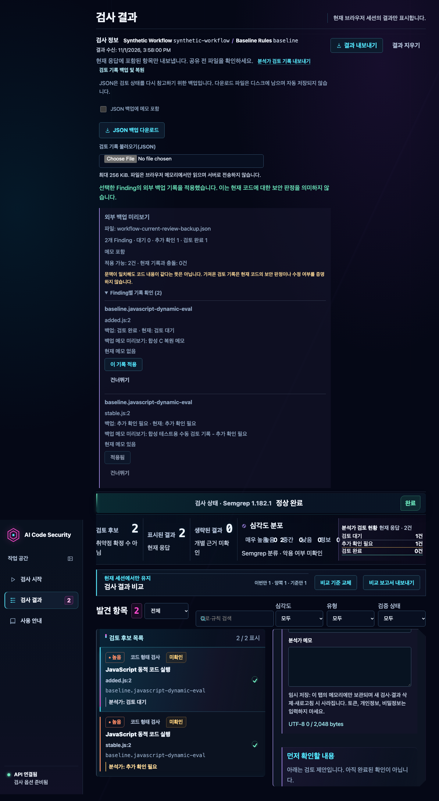

# Phase 8F — 실제 분석가 보안 분석 워크플로 E2E 검증

## 목적과 범위

이 검증은 임시로 생성한 합성 JavaScript 프로젝트를 대상으로, 실제 FastAPI와 Semgrep 1.182.1을 연결해 Phase 8A~8E의 검사·검토·내보내기·비교·복원 흐름이 함께 작동하는지 확인한다. 실제 조직 코드의 탐지 정확도나 취약점 판정 성능을 검증하지 않는다. 합성 코드는 실행하지 않고 Semgrep 정적 분석만 수행한다.

## 시작 Gate와 환경

- Repository: `misosos/ai-code-security-analyzer`
- 기준 SHA / `origin/main` / GitHub `main`: `5e3809eec264713fe90d4f9390bfcf1409e68637`
- GitHub Actions Run `41280103986`: `push / completed / success`; Python, Semgrep 통합, React dashboard job 성공; artifact 0개
- 격리 worktree: `/tmp/ai-csa-phase8f`
- 브랜치: `phase/8f-workflow-validation`
- OS: macOS 15.7.7 (arm64)
- Python: `uv run --locked` 환경 3.12.7 (시스템 기본 Python 3.11.8)
- uv: 0.11.26
- Node.js: 24.22.2
- Semgrep: 1.182.1
- Playwright: 1.64.1; Chromium 실행 파일은 Playwright가 설치된 Chromium 1248
- 신뢰 규칙: 저장소의 `security-baseline.yml`, profile ID `baseline`; 규칙 `baseline.javascript-dynamic-eval`

## 테스트 구조

`run-real-semgrep-e2e.mjs`가 기존 실제 E2E 대상과 분리된 `synthetic-project-workflow`를 자체 임시 디렉터리에 만든다. 러너가 API에 사전 등록한 경로만 스캔할 수 있고, 새 공개 API나 테스트용 파일 수정 API는 추가하지 않았다. 새 Playwright 시나리오는 `real-analyst-workflow.spec.ts`이며 실제 E2E 설정은 `real-*.spec.ts`를 worker 1개로 순차 실행한다. CI는 기존 `npm run test:e2e:real` 단계를 그대로 사용하므로 신규 시나리오도 필수 Real E2E 단계에서 실행된다. 일반 브라우저 테스트에서는 `real-*.spec.ts`를 제외해 mock 테스트와 실제 Semgrep E2E를 분리한다.

러너가 소유한 임시 프로젝트 파일만 테스트 중 변경하고, `finally`에서 loopback 서버 종료와 임시 디렉터리 제거를 보장한다.

## 합성 프로젝트와 탐지 변화

첫 검사 전 파일은 다음과 같다.

| 역할 | 경로 | 코드 변화 |
| --- | --- | --- |
| A — 유지 | `stable.js:2` | `eval(input)` 유지 |
| B — 이후 매치 제거 | `retired.js:2` | 최초에는 `eval(input)`, 후속에는 `return input` |
| C — 이후 추가 | `added.js:2` | 재검사 전에 `new Function(input)()` 추가 |

세 파일은 러너가 소유한 임시 검사 경로 안에서만 생성·수정한다. 초기 응답은 정상 완료, `completed=true`, Finding 2건, 생략 0건이었다. 재검사도 정상 완료, Finding 2건, 생략 0건이었다.

| 분류 | 기대 | 실제 | Finding ID |
| --- | ---: | ---: | --- |
| 이번 검사에서만 관찰 | 1 | 1 | `semgrep:2658f0d45e68f198ab258ec8` — `added.js:2` |
| 양쪽 검사에서 관찰 | 1 | 1 | `semgrep:6815898d3fb6927769974ffc` — `stable.js:2` |
| 기준 검사에서만 관찰 | 1 | 1 | `semgrep:311dcc906715497855d7fc07` — `retired.js:2` |

A의 ID는 두 응답에서 실제 동일했다. B의 매치는 후속 검사에서 나오지 않았고, C는 후속 검사에서 실제 탐지됐다. 이는 동일 규칙과 위치 기반 Finding ID에 대한 관찰 차이다. B가 사라진 것을 수정 완료로, C를 새 취약점 발생으로 해석하지 않는다. 코드 의미의 동일성이나 스냅샷 동일성도 증명하지 않는다.

## 분석가 기록, 내보내기 및 복원

- 기준 결과는 첫 결과 뒤 명시적으로 `비교 기준으로 지정`을 눌러 저장했다. 사용자 클릭 전 비교 보고서 내보내기는 비활성화 상태였다.
- A에는 `추가 확인 필요`와 합성 메모를, B에는 `검토 완료`와 별도 합성 메모를 지정했다. API의 `verification_status=unverified`, 심각도 및 근거 연결 상태는 변경되지 않았다.
- 현재 검사 Markdown, 분석가 검토 Markdown, JSON 백업을 실제 브라우저 다운로드 이벤트로 받았고 고정 파일명을 검사했다. 기본 보고서와 기본 JSON 백업에는 메모 문자열이 없었다. JSON 메모 포함 확인을 취소했을 때 다운로드 이벤트가 발생하지 않았고, 명시적으로 동의한 백업에는 선택된 메모만 포함됐다.
- 코드 변경 후 새 검사 확인을 취소하면 기존 기록이 보존됐다. 재검사를 확정하면 기존 검토 상태·메모가 초기화됐고 동일 ID의 A에도 자동 승계되지 않았다. 첫 기준 스냅샷은 유지됐다.
- 비교 결과에서 세 범주의 실제 경로와 개수를 확인하고 비교 Markdown을 다운로드했다. 세 Finding ID와 두 검사 문맥, Semgrep 버전이 포함됐고 분석가 메모는 포함되지 않았다.
- A/B가 든 최초 백업은 A/C인 현재 결과에서 `Finding ID 구성이 다릅니다` 이유로 복원이 차단됐다. 공통 A만 일부 적용하는 동작도 없었다.
- 동일한 A/C 메타데이터로 새 검사한 뒤 JSON 파일 선택은 미리보기만 만들고 상태를 바꾸지 않았다. A만 선택 적용할 때 덮어쓰기 취소는 현재 상태·메모를 보존했고, 확인 후 적용은 백업 기록과 외부 백업 출처를 표시했다. C는 적용하지 않아 `검토 대기` 및 빈 메모를 유지했다.

## 보안 및 상태 오염 검증

- 토큰은 매 검사 요청의 `x-local-api-token` 헤더에만 있었고 URL·페이지·다운로드에 나타나지 않았다.
- 모든 검사 응답, 페이지, 세 종류 Markdown/JSON 다운로드에 임시 절대 경로와 canary 문자열이 없었다. 합성 원본 코드와 canary 주석은 결과 파일에 노출되지 않았다.
- 브라우저 검사 요청은 정확히 3회였으며 모두 동일한 `synthetic-workflow` 대상이었다. 다운로드·비교·백업 불러오기는 추가 API 호출을 만들지 않았다. 외부 origin 요청은 0회였다.
- localStorage와 sessionStorage는 비어 있었다. 앱은 검토 상태를 React 메모리에서만 관리하고, 테스트 러너는 백업 파일을 러너 전용 임시 경로에만 둔다.
- 세 검사 응답 모두 `unverified`였으며 분석가 상태는 응답 Finding을 변경하지 않았다. 취약점 해결이나 안전성 보장을 표시하지 않았다.

## 실제 브라우저 증거

신규 E2E는 최종 단계의 결과·검토 상태 화면을 1440×900으로 캡처했다. 이미지에는 합성 프로젝트 데이터만 들어 있고 토큰, 절대 경로, 코드 원문은 포함되지 않는다.



Playwright 실제 합성 E2E 내부에서 1920, 1440, 1024, 768, 390, 320px 폭의 `documentElement.scrollWidth <= clientWidth`를 확인했다. 전체 UI 회귀에서 D3 Finding 목록 시작 위치 측정 기준도 실행했다.

## 검증 결과

| 검증 | 결과 |
| --- | --- |
| `uv lock --check` | PASS |
| Frontend `npm run typecheck` | PASS |
| Frontend `npm test` | PASS — 11개 파일, 106개 테스트 |
| Frontend `npm run build` | PASS |
| 전체 mock/합성 Chromium `npm run test:browser` (격리 포트 4174) | PASS — 24개 테스트; D3 목록 시작 기준 포함 |
| 실제 Chromium + FastAPI + Semgrep `npm run test:e2e:real` | PASS — 기존 실제 E2E와 신규 워크플로 E2E, 2개 테스트, 1 worker; 최종 런타임 22.655초 |
| Semgrep 버전 | PASS — 1.182.1 |
| Python 전체 `uv run --locked python -m pytest -q -rs` | 최종 PASS — 542 passed, 28 skipped, 1 경고, 286.60초 |
| Python 실패 테스트 추적 | 최초 전체 실행 540 passed, 28 skipped, 2 Semgrep timeout; 두 사례 단독 재실행 각 PASS (4.72초 / 9.73초), 부하가 정리된 전체 재실행에서 542개 PASS |
| CI Semgrep 통합 파일 묶음 | PASS — 44 passed, 1 경고, 237.93초 |
| `git diff --check` | PASS |

주요 실행 명령은 다음과 같다.

```bash
uv lock --check
uv run --locked python -m pytest -q -rs
SEMGREP_REQUIRED=1 SEMGREP_SEND_METRICS=off SEMGREP_ENABLE_VERSION_CHECK=0 uv run --locked python -m pytest -q -rs [CI Semgrep 통합 테스트 파일 목록]
CI=1 BROWSER_TEST_PREVIEW_PORT=4174 mise exec node@24 -- npm run test:browser
SEMGREP_REQUIRED=1 SEMGREP_SEND_METRICS=off SEMGREP_ENABLE_VERSION_CHECK=0 mise exec node@24 -- npm run test:e2e:real
```

Semgrep 통합 파일 묶음은 CI와 동일하게 `tests/test_semgrep_integration.py`, `test_scan_e2e.py`, `test_security_baseline.py`, taint·command-injection·API·Firestore·React HTML·trace 테스트를 전달한 아래 명령으로 순차 실행했다.

```bash
SEMGREP_REQUIRED=1 SEMGREP_SEND_METRICS=off SEMGREP_ENABLE_VERSION_CHECK=0 uv run --locked python -m pytest -q -rs \
  tests/test_semgrep_integration.py tests/test_scan_e2e.py tests/test_security_baseline.py \
  tests/test_semgrep_taint_evaluation.py tests/test_command_injection_taint.py \
  tests/test_command_injection_hardening.py tests/test_command_injection_phase6f.py \
  tests/test_api_semgrep_e2e.py tests/test_firestore_context_validation.py \
  tests/test_react_html_phase6g.py tests/test_eval_taint_phase6h.py tests/test_taint_trace_phase6i.py
```

전체 Python 첫 실행에서 시간 초과된 테스트는 `tests/test_command_injection_phase6f.py::test_semgrep_phase6f_shell_semantics_and_false_positive_resistance` 및 `tests/test_eval_taint_phase6h.py::test_phase6e_examples_keep_their_historical_labels_and_observed_matches`였다. 각각 단독 실행에 통과했고, 이후 전체 suite도 통과했다.

초기 브라우저 실행은 production `dist`가 없는 상태에서 404가 났다. CI와 동일하게 build 후 재실행했다. E2E 개발 중 selector/접힘 상태 기대와 다운로드 이벤트 개수 assertion을 수정해 재실행했다. 마지막 이벤트 assertion은 세 Markdown/JSON 다운로드에 비교 보고서 다운로드 한 건을 더 포함하도록 바로잡았고, 취소 시 실제 download 이벤트가 0회 증가함을 포함해 최종 재실행 2개 테스트가 통과했다. 전체 브라우저 테스트의 첫 실행은 기존 포트 4173의 원래 main worktree 개발 서버를 재사용해 부정확한 결과가 나왔다. 해당 서버는 중단하거나 수정하지 않았다. 이후 preview 포트를 설정 가능하게 하고 CI 모드에서 4174의 격리 worktree build를 사용해 24개 전체를 통과했다. `playwright.config.ts`의 test ignore는 실제 E2E와 mock E2E를 분리한다. 사용 중단된 초기 테스트 두 번에서 러너 소유 임시 디렉터리가 남았으나, 검증한 두 경로만 격리 조건으로 정리했다. 최종 성공 E2E에서는 runner `finally`가 API 프로세스와 임시 프로젝트를 정리했고 잔여 임시 디렉터리는 없었다.

## 한계

- 합성 코드 세 패턴과 baseline 정적 규칙만 검증했다. 실제 제품 코드나 조직 코드의 정확도는 검증하지 않았다.
- Finding ID는 rule ID 및 상대 경로·위치 기반 해시다. 코드 이동 시 동일 의미 탐지가 다른 ID가 될 수 있다.
- 테스트는 macOS Chromium에서 수행했다. 실제 Safari, VoiceOver, 실제 모바일 기기, 200% 브라우저 확대, axe는 실행하지 않았다.
- 다운로드 파일은 브라우저 메모리 초기화나 결과 삭제로 제거되지 않는다. 사용자가 디스크에 저장한 JSON/Markdown은 별도 관리 대상이다.
- 이 문서는 CLI 정식 보안 검토 보고서나 실제 취약점 확인을 대체하지 않는다.

## 변경 파일과 CI 상태

변경은 실제 E2E 테스트/설정/러너와 이 문서 및 synthetic-only 스크린샷으로 한정한다. API, Semgrep 규칙, CLI, React 제품 코드와 DTO는 수정하지 않았다. 새 로컬 커밋 이후 해당 SHA의 GitHub Actions는 아직 실행되지 않았으므로 원격 CI 결과는 `NOT_VERIFIED`다.
