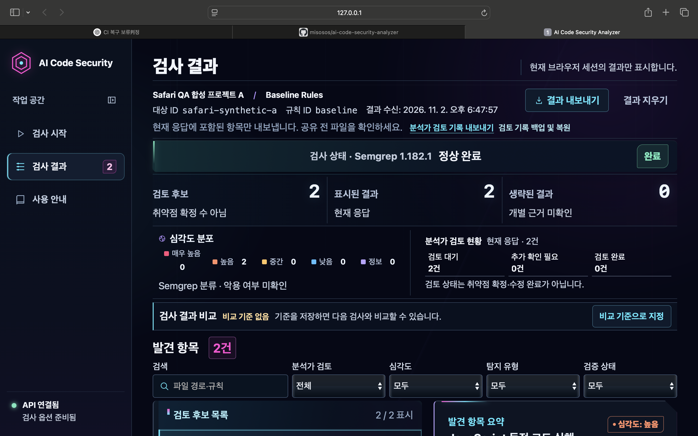
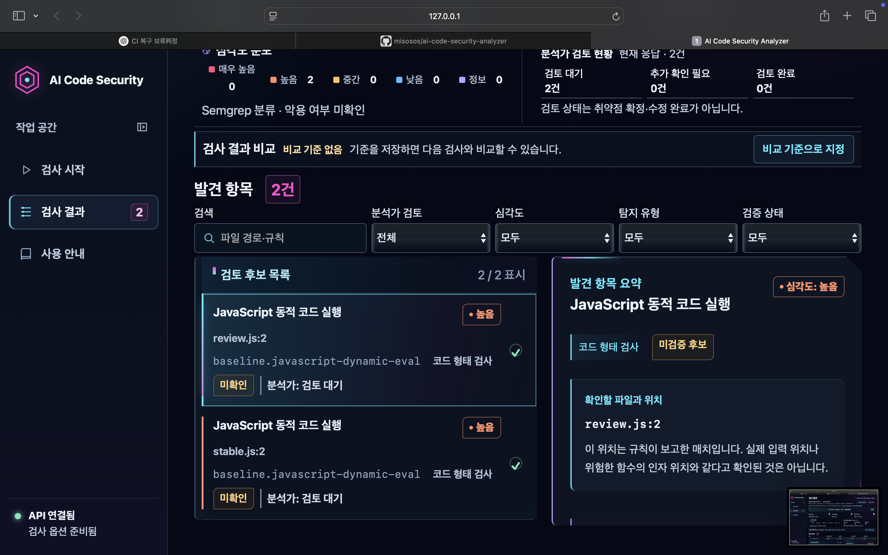
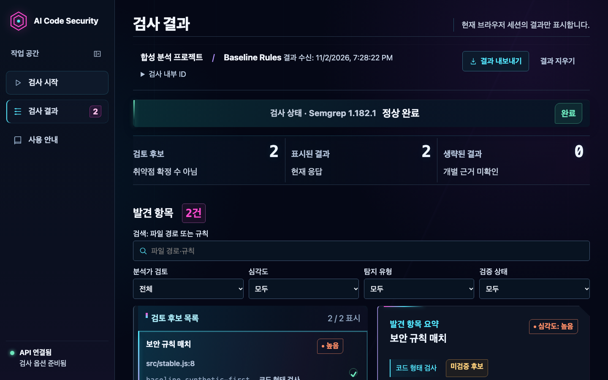
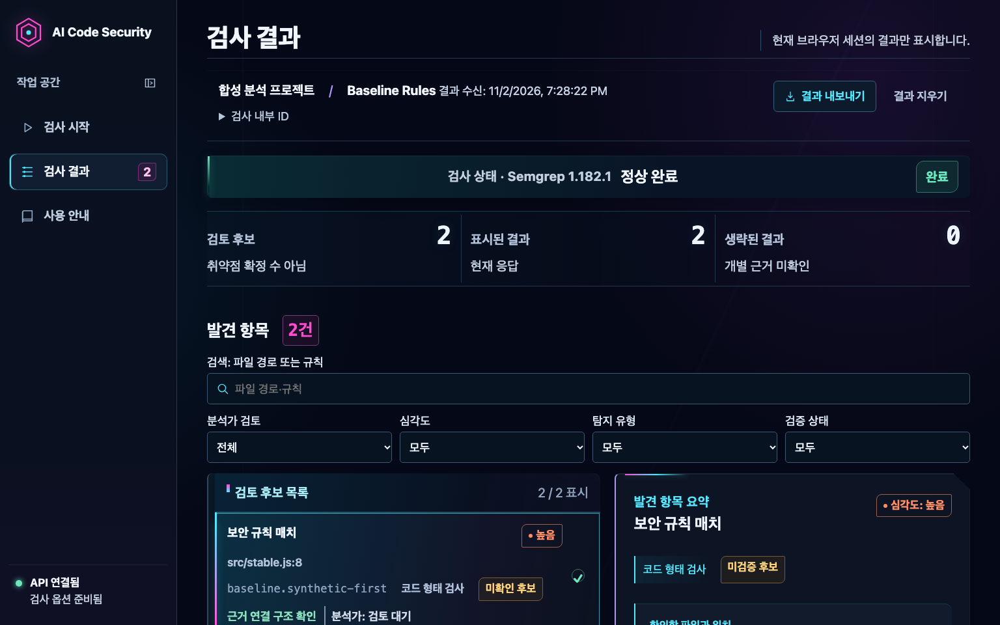
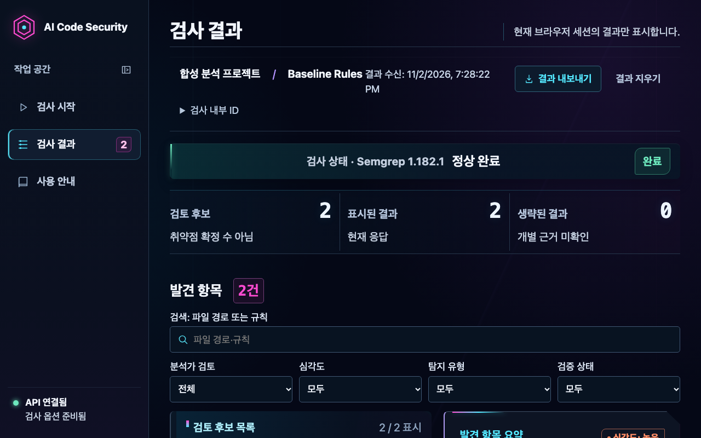
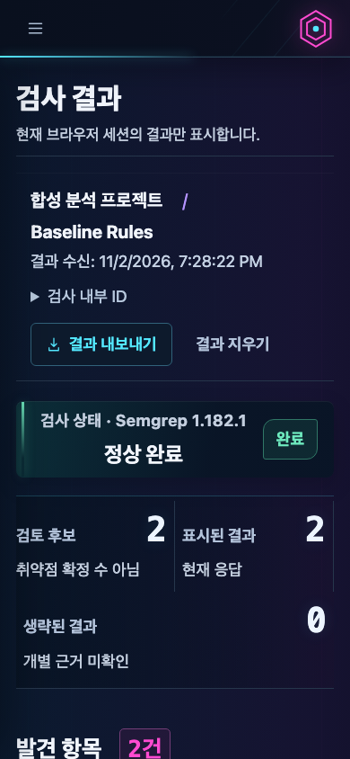
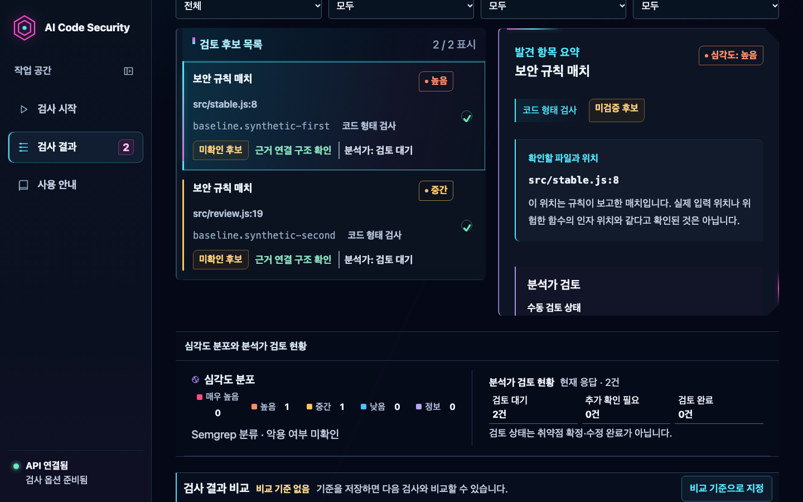
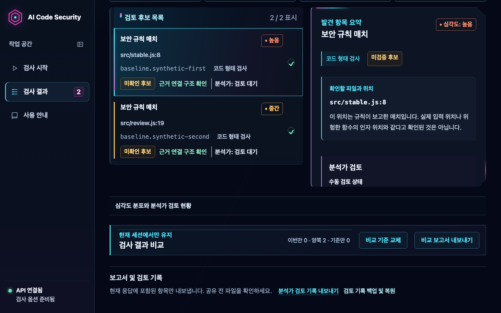
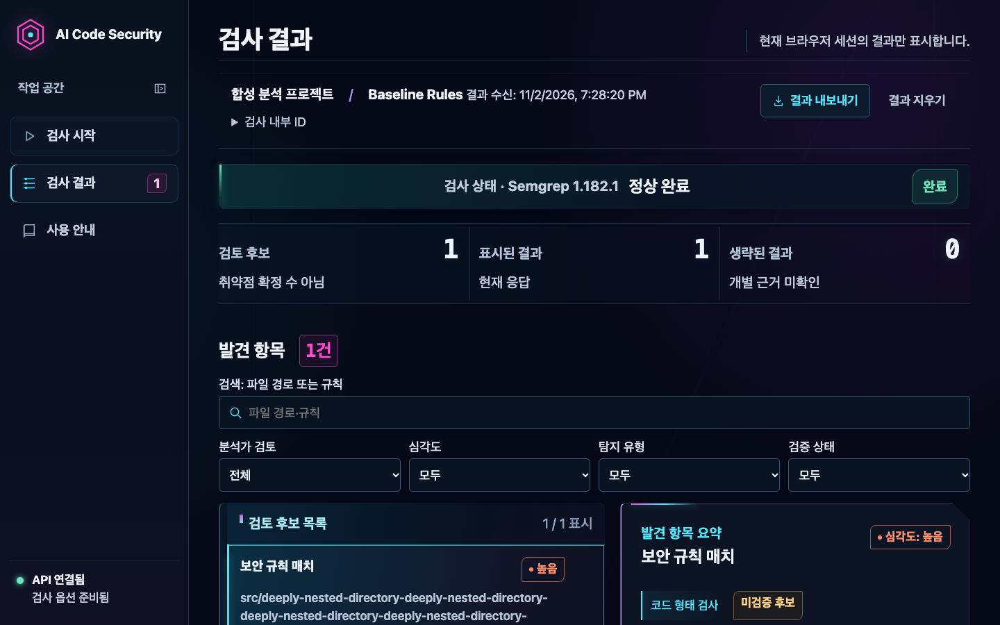

# Phase 8H-UI Readability — Finding 중심 결과 화면

## 목적과 시작 Gate

사용자가 제공한 macOS Safari 화면에서 검사 정보, 통계, 비교, 검색·필터가 Finding 목록보다 먼저 밀집해 보이는 문제를 확인했다. 이 변경은 결과 화면의 업무 순서를 Finding 검토 중심으로 재배치한다.

- 기준 SHA: `ff7e54e657b9e94b54e81ce031bc2413771c5a61`
- GitHub Actions: `41421507394` — push / completed / success
- Python·Semgrep 1.182.1·React dashboard·Chromium·실제 FastAPI–Semgrep E2E: 성공
- Artifacts: 0개
- 격리 worktree: `/tmp/ai-csa-phase8h-ui-readability`
- 실제 Safari 사용 승인: `SAFARI_USER_ACCEPTANCE_PENDING`

## 변경 전 관찰

제공된 Safari 캡처에서는 검사 정보와 내보내기 링크, 검사 상태, 핵심 수치, 심각도·분석가 검토 현황, 비교 패널, 다섯 검색·필터 컨트롤이 차례로 쌓여 Finding 목록의 시작을 늦췄다. 필터가 한 행에 몰렸고 Finding 카드의 위치·규칙·검증·분석가 상태가 같은 밀도로 표시됐다.

아래 Safari 캡처는 사용자가 제공한 참고 이미지다. 자동화에서 다시 만든 이전 화면이 아니며, 이후 Chromium 캡처와 브라우저·화면 크기·배율이 같다고 간주하지 않는다.

## 변경 후 정보 구조

1. 결과 페이지 이름과 브라우저 세션 안내
2. 프로젝트 표시명, 규칙 프로필, 결과 수신 시각, 접을 수 있는 내부 ID, 현재 결과 내보내기·결과 지우기
3. 검사 상태 및 항상 보이는 생략 결과 경고
4. 검토 후보·표시 결과·생략 결과 핵심 수치
5. Finding 제목과 검색 행
6. 분석가 검토·심각도·탐지 유형·검증 상태 필터 행
7. Finding 목록과 선택 항목 상세
8. 접힌 상태의 심각도 및 분석가 검토 분석
9. 비교 결과
10. 분석가 Markdown 및 JSON 백업·복원 도구

내부 ID는 `검사 내부 ID` 접기 영역으로 옮겼다. 상세 통계는 `심각도 분포와 분석가 검토 현황` 접기 영역에 두었다. 부분 검사와 생략 Finding 경고는 이 영역 밖에서 항상 표시된다. 비교 알고리즘, 비교 범주, 기준 저장 동작은 유지했고 기준 미지정 상태는 Finding 목록 이후에 compact하게 표시한다.

### 검색과 필터

검색 입력을 독립된 첫 행으로 배치하고 네 필터는 두 번째 행에 정렬했다. 다섯 컨트롤 모두 시각적 레이블과 접근 가능한 이름을 제공한다. 검색·필터 교집합 동작과 선택된 Finding 관리 로직은 변경하지 않았다.

### Finding 정보와 검토 상태

목록/상세 2열 레이아웃을 유지하면서 카드에서 제목·심각도, 상대 경로·행 번호, 규칙 및 검토 메타데이터가 순서대로 읽히게 했다. 긴 규칙 ID와 경로는 줄바꿈한다. 선택 상태는 기존 강조선·배경, 키보드 포커스 및 `aria-pressed`로 전달한다. 검증 상태를 `근거 연결 구조 확인` 또는 `근거 연결 확인 불가`로 표시하되, 취약점 확정 문구로 승격하지 않는다.

분석가 검토 완료와 추가 확인 필요는 Semgrep 검증 상태와 별도 상태로 남는다. 핵심 수치와 생략 범위의 의미 문구도 유지한다.

## 화면 측정과 시각 검토

1440×900, 동일한 Chromium 합성 응답에서 기존 수용 측정과 새 측정을 비교했다.

| 측정 | 변경 전 | 변경 후 | 변화 |
| --- | ---: | ---: | ---: |
| Finding 목록 document Y | 788px | 724.4px | 63.6px 앞당김 |
| 첫 Finding 행 document Y | 848px | 784.4px | 63.6px 앞당김 |

기존 UI-D3 기준 `<810px` 및 `<870px`와 가독성 여유 기준 `<790px` 및 `<850px`를 모두 통과했다. 새 측정은 상세한 검사 문맥을 접기 영역으로 정리하고, Finding 이후로 통계·비교·보조 내보내기를 옮긴 결과다.

수정 후 캡처는 합성 Finding만 사용한다.

세로 위치 측정과 CSS viewport 확대 대리 검증은 자동 Chromium 결과다. 실제 Safari 200% 확대는 사용자가 수행해야 한다.

## 반응형과 글자 크기

1920, 1536, 1440, 1280, 1024, 768, 600, 390, 320px에서 Toolbar 및 넘침 회귀를 확인했다. 320px까지 문서 가로 넘침이 없었고, 1024px 이하에서는 필터를 2열로, 380px 이하에서는 1열로 재배치한다. 모바일 결과 화면에서는 상단 Drawer 구조와 Finding 목록/상세의 세로 흐름을 유지한다.

기존 글자 크기를 축소하지 않았다. 본문 20px, 주요 제목 36px 이상, 검색·필터 18px, Sidebar 19px 기준을 유지하고 핵심 수치 38px 기준을 보존했다. 가독성 테스트에서 새로 노출된 메타데이터와 근거 연결 문구가 기존 크기 하한에 미달하는 것을 발견해 18px로 올리고 재검증했다.

## 자동화 검증

주요 실행 환경은 Node.js 24.22.2, Python 3.12.7, Semgrep 1.182.1이다. Playwright는 격리된 preview 포트를 사용했다.

| 검증 | 명령 | 결과 |
| --- | --- | --- |
| TypeScript | `mise exec node@24.22.2 -- npm run typecheck` | PASS |
| Vitest | `mise exec node@24.22.2 -- npm test` | 106 passed |
| Production build | `mise exec node@24.22.2 -- npm run build` | PASS |
| Chromium 전체 | `BROWSER_TEST_PREVIEW_PORT=4210 mise exec node@24.22.2 -- npm run test:browser` | 45 passed; axe 7 상태 포함 |
| WebKit 전체 | `BROWSER_TEST_PREVIEW_PORT=4211 mise exec node@24.22.2 -- npm run test:browser:webkit` | 2 passed |
| 실제 browser E2E | `SEMGREP_REQUIRED=1 mise exec node@24.22.2 -- npm run test:e2e:real` | 재실행 2 passed (16.6s) |
| Safari QA 테스트 | `mise exec node@24.22.2 -- npm run test:qa:safari` | 7 passed |
| Python 전체 | `uv run --locked python -m pytest -q -rs` | 542 passed, 28 skipped, 1 경고 |
| Semgrep 통합·API E2E | `uv run --locked python -m pytest -q -rs tests/test_semgrep_integration.py tests/test_semgrep_taint_evaluation.py tests/test_api_semgrep_e2e.py` | 7 passed |
| 잠금 파일 | `uv lock --check` | PASS |
| diff 공백 검사 | `git diff --check` | 최종 확인 예정 |

Python의 28개 skip은 기존 Ollama 검증용 선택 시나리오이며 설정된 환경이 없어 실행하지 않았다. E2E 첫 시도는 `SEMGREP_REQUIRED=1`을 지정하지 않아 즉시 중단됐다. 그 뒤 실제 Semgrep 시나리오에서 기존 분석가 Markdown 다운로드 locator가 예전 검사 설정 패널을 찾으며 360초 timeout이 발생했다. 다운로드 기능 자체를 가리키도록 새 보고서 영역과 버튼 이름에 맞춰 locator를 수정했고, 동일한 실제 FastAPI–Semgrep–Chromium E2E를 재실행해 2개 테스트가 16.6초에 통과했다. E2E 러너의 임시 디렉터리와 서버는 정리됐음을 확인했다.

axe 자동 검사는 자동화된 검사 상태를 대상으로 한 7개 테스트를 포함한다. 이 결과를 WCAG 전체 준수 또는 실제 Safari 승인으로 확대 해석하지 않는다. Playwright WebKit은 Safari 앱 자체 테스트가 아니다.

## 남은 검증

- 실제 macOS Safari에서 화면별 확인 및 사용자 승인: `SAFARI_USER_ACCEPTANCE_PENDING`
- 실제 Safari 200% 페이지 확대: 미실행, 수동 검수 필요
- 실제 VoiceOver 및 iOS Safari: 이 작업에서 수행하지 않음
- GitHub Linux CI: 원격 CI는 신규 커밋 Push 이후 확인 필요
