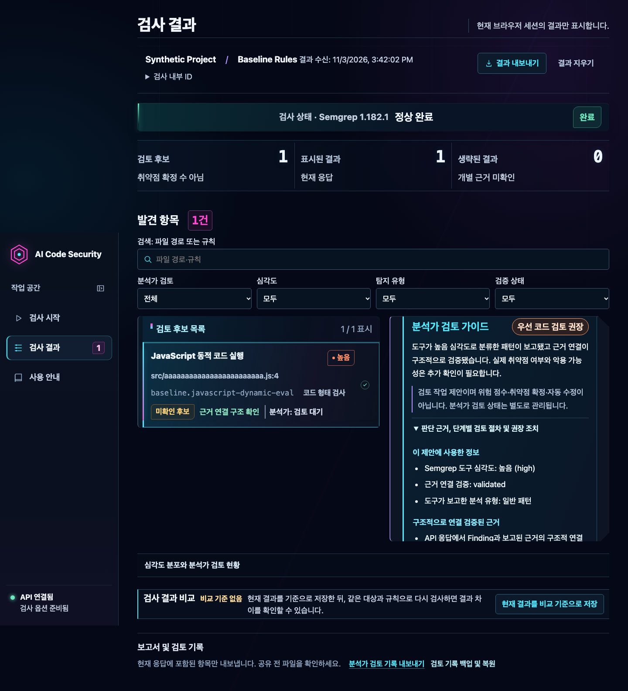
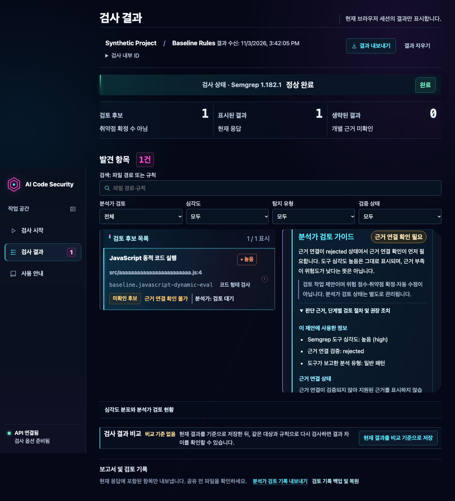
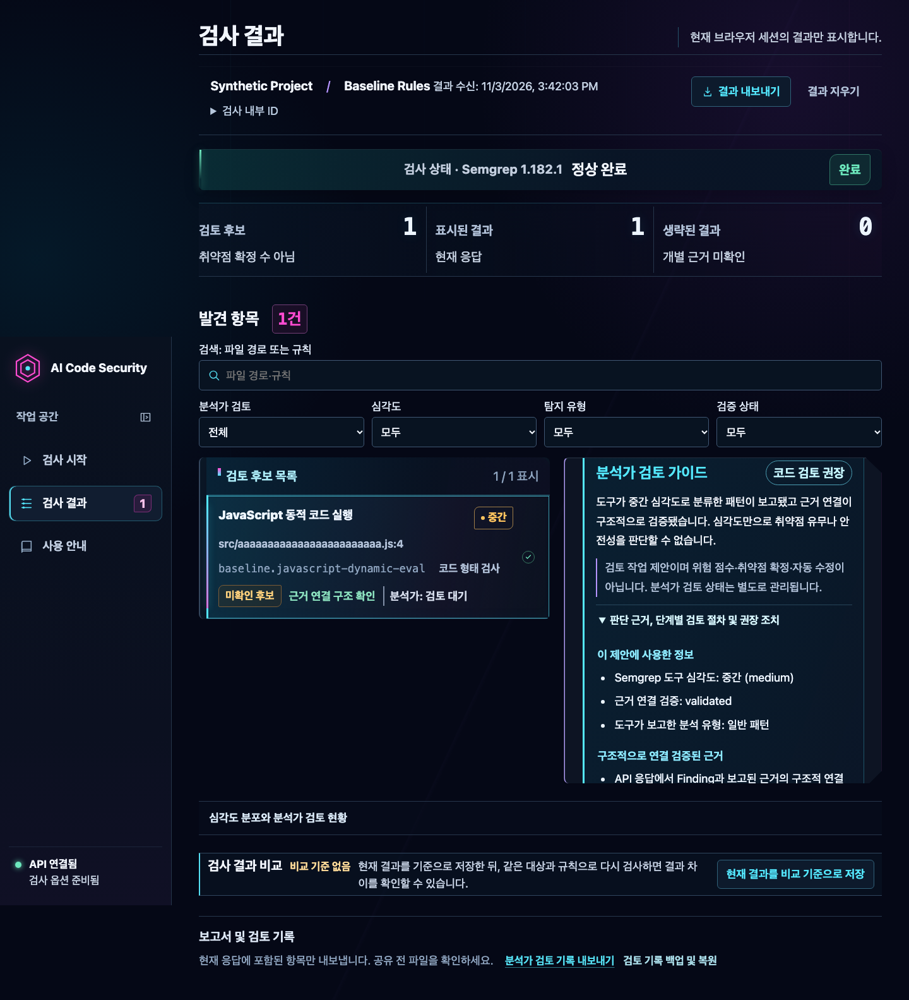
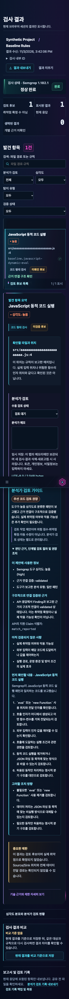

# Phase 8K — Finding별 분석가 검토 가이드

## 목적과 범위

Finding 상세에서 분석가가 먼저 확인할 연결 근거, 코드 검토 절차, 고려할 조치 방향을 볼 수 있도록 했다. 이 기능은 정적 분석 응답을 바탕으로 고정된 검토 작업을 제안한다. 취약점을 확정하거나 실제 위험도를 점수화하지 않는다.

시작 Gate는 기준 SHA `ace4e8c5dc451545e7aedf12ef915762964636d3`에서 확인했다. `origin/main`과 GitHub `main`이 모두 해당 SHA와 일치했고, GitHub Actions Run `41588258695`는 `push / completed / success`였다. Python tests and CLI, Semgrep 1.182.1 integration, React dashboard와 FastAPI–Semgrep E2E가 성공했고 Artifacts는 0개였다.

구현 worktree는 `/tmp/ai-csa-phase8k-triage`, 브랜치는 `phase/8k-finding-triage-guidance`다. 원본 Desktop 작업 트리의 미커밋·미추적 자료와 별도 Safari QA 서버는 변경하거나 종료하지 않았다.

## 분류 계약

`frontend/src/features/scans/findingTriage.ts`의 순수 함수 `createScanTriage()`는 이미 API 검증을 통과한 `ScanResponse`만 받아 Finding별 제안과 검사 범위 경고를 결정론적으로 만든다. Finding 입력 순서를 그대로 유지하며 목록을 숨기거나 다시 정렬하지 않는다.

| 입력 상태 | 화면 제안 | 의미 |
| --- | --- | --- |
| `evidence_validation_status`가 `rejected` 또는 `unavailable` | 근거 연결 확인 필요 | 근거 연결 상태를 먼저 살핀다. High/Critical 등 도구 심각도는 그대로 표시하며, 근거 부족을 낮은 위험으로 해석하지 않는다. |
| 근거 연결 `validated` + 심각도 `critical` 또는 `high` | 우선 코드 검토 권장 | 도구 심각도와 구조적 연결 상태에 따른 검토 제안이다. 취약점·악용 가능성의 확정은 아니다. |
| 근거 연결 `validated` + 심각도 `medium`, `low`, `info` | 코드 검토 권장 | 낮은 심각도만으로 취약점 부재나 안전성을 뜻하지 않는다. |

부분 검사, 실패·시간 초과 등 정상 완료되지 않은 응답이나 생략 Finding이 있으면 표시된 Finding에 한정된 범위 안내를 추가한다. 전체 검사 우선순위라고 주장하지 않는다. 표시된 Finding이 0건이면 빈 목록을 유지하고 0건이 안전성 증명이 아니라는 기존 안내를 보존한다.

점수, CVSS, 악용 가능성 추정, 자동 수정 또는 취약점 확정은 만들지 않는다. `verification_status`와 근거 상태를 바꾸지 않으며, `reviewed` 상태도 triage 제안을 완료·해결로 바꾸지 않는다. 분석가 메모는 기존 2 KiB 제한, 세션 메모리 전용 및 기존 백업 정책을 유지한다.

## 규칙별 안내와 Phase 8J 보고서

`frontend/src/features/scans/reviewGuidance.ts`에 알려진 규칙의 이름, 설명, 검토 단계와 조치 제안을 한 곳에 정의했다. 화면과 `markdownExport.ts`가 같은 매핑을 사용한다.

- `baseline.javascript-dynamic-eval`: `eval`/`new Function` 위치와 인자, 값 생성·전달, 외부 입력 영향, 실행 조건·권한을 확인한다. 제거, 목적에 맞는 JSON 파싱, 허용 동작을 처리하는 명시적 분기 구조를 대안으로 제안한다.
- `baseline.react-dangerous-html`: `dangerouslySetInnerHTML`와 `__html` 값의 출처, 신뢰 경계, 문맥에 맞는 정제 적용을 확인한다. 일반 텍스트 출력 대체를 검토한다. Sanitizer의 존재나 효과는 가정하지 않는다.
- `baseline.firestore-unconditional-write`: `allow`/`match` 범위, 상위·중첩 선언, 인증·소유권, 로컬과 배포 규칙의 차이를 확인한다. 무조건 권한 필요성 재검토와 최소 권한 범위 축소를 제안한다. 운영 배포 상태를 관찰했다고 주장하지 않는다.
- 알려지지 않은 규칙 ID: Finding 유형별 고정 일반 절차를 사용한다. 사용자 문자열로 취약점 이름, CWE 또는 템플릿을 만들지 않는다.
- Taint 유형: 실제 Source/Sink 코드 위치와 규칙 선언을 구분하고, 제공된 Flow Trace 및 Sanitizer 근거의 범위를 확인하도록 제안한다. 일반 Pattern은 매치 주변 코드, 값 출처, 방어 조건과 실행 경로를 확인하도록 제안한다. 어느 유형도 자료에 없는 데이터 흐름을 생성하지 않는다.

권장 작업은 접을 수 있는 `분석가 검토 가이드` 안에 둔다. 제안의 요약과 근거 상태는 기본으로 보이며, 자세한 단계와 조치만 펼쳐서 확인한다. 기존 분석가 상태 편집기, 메모, 기술 근거와 제한을 유지한다. 비교 화면에 검사 범위가 전달되지 않을 때는 우선순위를 만들지 않고 일반 검토 안내만 보여준다.

Phase 8J의 읽기용 UI Markdown에는 공유 안내의 조치 방향을 추가했으며 기존 Claim·Decision·Reason Code 부록과 512 KiB 상한을 보존했다. CLI `review-md`, API DTO, Finding/Evidence 계약, Semgrep 규칙, 분석가 Markdown·JSON 백업 및 비교 알고리즘은 변경하지 않았다.

## 합성 화면 캡처

캡처는 Playwright의 합성 API 응답만 사용했다. 실제 코드나 비밀정보는 포함하지 않는다. 확대된 상세 안내는 상세 패널 내부 스크롤로 이어진다.

### High + validated · 1440×900



### High + rejected · 1440×900



### Medium + validated · 1440×900



### 상세 가이드 펼침 · 390×844



## 검증

환경: macOS arm64, Node.js `v24.22.2`, npm `11.19.1`, Python `3.12.7`, uv `0.11.26`, Semgrep `1.182.1`.

| 검증 | 명령 | 결과 |
| --- | --- | --- |
| TypeScript | `mise exec node@24 -- npm run typecheck` (`frontend/`) | PASS |
| Vitest 전체 | `mise exec node@24 -- npm test -- --reporter=dot` (`frontend/`) | 132 passed, 12 files |
| Production build | `mise exec node@24 -- npm run build` (`frontend/`) | PASS |
| Chromium 전체 | `BROWSER_TEST_PREVIEW_PORT=41865 CI=1 mise exec node@24 -- npm run test:browser` | 48 passed; axe 7개 시나리오 포함 |
| Playwright WebKit | `BROWSER_TEST_PREVIEW_PORT=41866 CI=1 mise exec node@24 -- npm run test:browser:webkit` | 2 passed |
| 실제 FastAPI–Semgrep–Chromium E2E | `SEMGREP_REQUIRED=1 SEMGREP_SEND_METRICS=off SEMGREP_ENABLE_VERSION_CHECK=0 mise exec node@24 -- npm run test:e2e:real` (`frontend/`) | 2 passed, 36.2초; 기존 합성 실제 검사 흐름에서 Finding별 가이드 확인 |
| Safari QA 환경 회귀 | `mise exec node@24 -- npm run test:qa:safari` (`frontend/`) | 7 passed |
| Python 전체 | `uv lock --check && uv run --locked python --version && uv run --locked python -m pytest -q -rs` | 542 passed, 28 skipped, 1 의존성 deprecation warning; 259.17초 |
| Semgrep 통합 | CI에 정의된 12개 테스트 파일을 `SEMGREP_REQUIRED=1`, metrics/version-check 비활성화로 실행 | 44 passed, 1 의존성 deprecation warning; 169.74초 |
| whitespace 검사 | `git diff --check` | PASS |

Semgrep 통합 실행은 CI의 `.github/workflows/ci.yml` 목록을 그대로 사용했다. 명령은 다음과 같다.

```bash
SEMGREP_REQUIRED=1 SEMGREP_SEND_METRICS=off SEMGREP_ENABLE_VERSION_CHECK=0 uv run --locked python -m pytest -q -rs \
  tests/test_semgrep_integration.py tests/test_scan_e2e.py tests/test_security_baseline.py \
  tests/test_semgrep_taint_evaluation.py tests/test_command_injection_taint.py \
  tests/test_command_injection_hardening.py tests/test_command_injection_phase6f.py \
  tests/test_api_semgrep_e2e.py tests/test_firestore_context_validation.py \
  tests/test_react_html_phase6g.py tests/test_eval_taint_phase6h.py \
  tests/test_taint_trace_phase6i.py
```

초기 Chromium 전체 실행은 46 passed / 2 failed였다. 생략 경고의 `role=alert`가 새 triage 범위 안내와 겹쳤고 새 소제목 16px가 가독성 테스트 기준보다 작았다. triage 범위 안내를 `role=note`로 조정하고 소제목을 18px로 올린 뒤 전체 48개 테스트를 다시 통과했다. 중간 Semgrep 명령에서 CI에 없는 파일 이름을 지정해 테스트가 시작되기 전에 종료된 시도도 있었으며, 저장소 CI의 실제 12개 파일 목록으로 다시 실행해 44개 통과했다. 최초 브라우저 집중 테스트는 production preview 빌드가 준비되기 전에 실행되어 화면을 찾지 못했으며, 빌드 후 재실행했다.

1440×900 Chromium UI-D3 측정은 Finding 목록 `documentY=724.44px`, 첫 행 `documentY=784.44px`였고 기존 기준을 유지했다. 합성 화면 회귀는 1920, 1536, 1440, 1280, 1024, 768, 600, 390, 320px에서 수평 overflow가 없는지 확인했다.

실제 macOS Safari, VoiceOver, 브라우저 실제 200% 확대, Linux Chromium은 이번 Phase에서 수행하지 않았다. CSS viewport/모바일 검사와 Playwright WebKit은 이를 대체하지 않는다. 사용자 수동 수용은 `SAFARI_USER_ACCEPTANCE_PENDING`이다.

## 남은 한계

검토 절차는 신뢰된 규칙과 검증된 API 필드만을 이용한 고정 안내다. 실제 소스 코드의 입력 영향, 실행 가능 경로, 배포 환경이나 방어 효과를 분석한 결론이 아니다. 검토자가 코드와 운영 맥락을 확인해야 한다.
