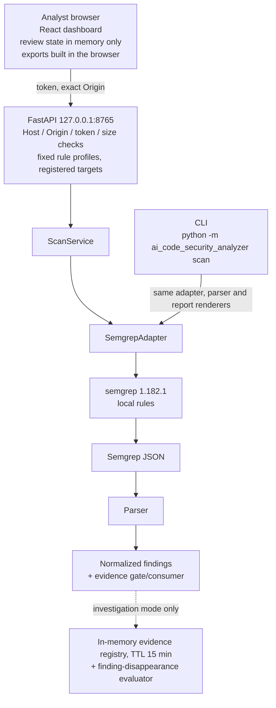

# Project Overview: SAST Review Workspace

This page explains what the project does today, how it is built, how it was validated, and where its limits are. Setup steps are in [Getting started](getting-started.md).

**Feature expansion is on hold; confirmed defects are fixed.** The idea described below was tested and did not hold up: in two experiments a short script on top of Semgrep and Git did as well as or better than this product. See the [research record](research/README.md).

## The problem

A SAST tool such as Semgrep reports candidate findings. An analyst then has to decide which candidates matter, record decisions, and later tell whether a finding that "disappeared" was really fixed or simply stopped being observed: the file was skipped, the rules changed, or the scan was incomplete.

Raw scanner output makes the last question easy to get wrong. A missing finding looks the same as a fixed one. This project explores how a local workspace can keep that distinction visible: every finding stays an **unverified candidate**, incomplete scans are refused for comparison, and a disappearance is reported as an observation with explicit evidence gaps rather than as remediation.

The product does keep that distinction: in the D1 experiment it never claimed a fix. But it identifies a finding by its line and column, so a finding that merely moved is itself reported as disappeared, and without Git data it can rarely say why a finding is gone. A 227-line script that reads `git diff` did both better ([D1 results](../experiments/d1-finding-disappearance/RESULTS.md)).

## What is implemented

| Component | What it does |
| --- | --- |
| Semgrep adapter | Runs the Semgrep 1.182.1 CLI with a trusted local rule file, a temporary `HOME`, metrics and version checks off, and strict output parsing. Partial runs and conversion loss are reported, not hidden. |
| Normalized finding model | Converts Semgrep JSON into findings with an ID, severity, and relative location, always marked unverified. The ID is a hash of rule, path, line, and column, so it is stable only while the code does not move: a line shift or rename produces a different ID. Reports omit source snippets and raw scanner JSON and identify targets by hash. |
| Evidence gate and consumer | Decides which narrow claims about a finding (for example, `match_reported`, `match_location_observed`, `flow_trace_available`) are supported, insufficient, unavailable, or ambiguous, and records the reason codes. |
| CLI | `scan` with text, JSON, analyst review, and Markdown review output. Report files are created new and never overwritten. |
| Local API | FastAPI on `127.0.0.1:8765`. Scans only targets registered at startup, with a fixed allowlist of rule profiles. |
| React dashboard | Scan, triage guidance, per-finding review status and notes, comparison of two complete scans, and browser-side exports (Markdown, SARIF 2.1.0, review backup JSON, comparison Markdown). |
| Investigation mode | A bounded `/api/v2` flow that records per-run evidence (scan manifest, processed paths, selected rule-file bytes) and evaluates why a finding ID was not observed in a later scan. The usual answer is `UNDETERMINED`, together with the specific missing evidence. |

Research modules for AI-assisted review (`ai_review.py`, `ollama_provider.py`, code-context extraction) are **not** connected to the CLI, API or dashboard. No shipped analysis path calls a language model.

## Architecture

## Core analyst workflow

1. **Register** one or more local targets when starting the API. The browser cannot pick arbitrary paths.
2. **Scan** a target with the baseline profile, or an experimental profile that is clearly labeled.
3. **Triage**: each finding shows rule, location, severity, triage guidance, and which evidence claims are supported or restricted.
4. **Record decisions**: review status and notes per finding, kept in browser memory. They can be exported as a backup and restored onto findings with the same IDs.
5. **Rescan and compare**: a second complete scan of the same target and profile is compared by finding ID. Partial, failed, or truncated scans are blocked from comparison. Because IDs depend on line and column, a finding whose code moved appears as one disappeared finding plus one new finding, and its review record does not follow it.
6. **Investigate a disappearance** (optional): investigation mode shows what evidence exists for a finding no longer observed and what is missing (source snapshot, full rule identity, scope completeness).
7. **Export**: Markdown summaries, SARIF 2.1.0, review records, or comparison reports, all generated from data already in the page.

## Security controls

Each control below is implemented in code at this commit. None of them amounts to a sandbox.

| Control | Implementation |
| --- | --- |
| Loopback only | The launcher binds `127.0.0.1:8765`. Host header allowlist: `127.0.0.1`, `localhost`. |
| Origin allowlist | Exact configured Origins only. No wildcard, no credentials. Any other `Origin` header gets `403`. |
| Token authentication | 43–256 URL-safe characters, required for scan and investigation endpoints. The dashboard keeps the token only in page memory. |
| Request and response limits | JSON content-type enforcement, request size limits, a 1 MiB default response cap, at most 50 findings per API response (omissions are counted). |
| Response hardening | OpenAPI and docs endpoints disabled; `no-store`, `nosniff`, `no-referrer` and a restricted CSP; sanitized error codes. |
| Scope restriction | Targets come from startup configuration (at most 32, absolute paths). Rules come from a separate trusted directory and a fixed profile list. |
| Data minimization | No source snippets or raw Semgrep JSON in reports; hashed target IDs; notes are included in exports only after explicit confirmation. |
| Semgrep execution hygiene | Temporary `HOME` and cache, metrics off, version check off, local rules only. |
| Fail-closed comparison | Incomplete, truncated or inconsistent scans are `INCOMPARABLE`; no finding is ever marked fixed. |

**Not provided:** OS-level network or filesystem isolation of Semgrep. A verifiable worker image is designed in [Phase 7C-1B](phase7c1b-verifiable-worker-design.md) but has not been built or run. Untrusted repositories must be scanned in a separately isolated environment.

## Reproducible validation

- **CI**: three required jobs on every push and pull request to `main` (Python tests and CLI; Semgrep 1.182.1 integration; React dashboard with a real Chromium–FastAPI–Semgrep end-to-end test). Third-party actions are pinned by commit SHA, and the workflow has read-only `contents` permission. The uv version is not pinned as intended: the workflow passes an input name that `setup-uv` ignores, so CI installs the latest uv ([details](research/frozen-state-known-limitations.md)).
- **Comparison experiments** ([D1](../experiments/d1-finding-disappearance/RESULTS.md), [D2](../experiments/d2-scanner-integrity/RESULTS.md)): pre-registered synthetic comparisons against stock Semgrep and a short script. The product was not better on any measure. These were designed and scored without an independent party.
- **Synthetic detection benchmarks** ([6A](phase6a-independent-detection-benchmark.md), [6D](phase6d-sast-generalization-evaluation.md), [6E](phase6e-heldout-sast-evaluation.md)): author-written synthetic corpora (50 cases in 6D, 60 pre-registered held-out cases in 6E), scored against each rule's declared scope. Within that scope no false positives or false negatives were observed in 6D and 6E. In 6E, 12 of 13 review-worthy cases **outside** the declared scope were not reported. These are rule-coverage results on small synthetic sets, not real-world precision or recall.
- **Investigation case studies**: [finding disappearance](case-studies/finding-disappearance-investigation.md) and [evidence boundaries](case-studies/investigation-evidence-boundaries.md), with [reproduction commands](er-d1-reproducibility-record.md).
- **Quickstart smoke check**: the README sample scan reproduces 7 unverified candidates from the committed fixtures with Semgrep 1.182.1.

## Known limitations

The full, evidence-linked list is in [Known limitations](known-limitations.md). In short:

- Findings are identified by line and column, so moved code looks like a disappeared finding.

- Detection is Semgrep with a small set of local rules. Documented false negatives include A8 (`const eval = globalThis.eval`).
- AI review is not part of the product.
- Partial scans stay `INCOMPARABLE`. Investigation over-abstention (S5a) is unresolved.
- No proof of remediation, no Git integration, no rename linking.
- Review state is in browser memory only. A confirmed rescan clears it only when the new scan completes normally; failed or partial rescans restore the previous result and its records.
- Investigation evidence expires after 15 minutes.
- SARIF passes schema validation, but GitHub Code Scanning upload is untested.
- There is no evidence of better detection or faster triage than Semgrep CLI plus Git, and two synthetic comparisons went the other way. There is no execution sandbox.

## Not implemented

Feature expansion is on hold, so none of the items below is scheduled. They are listed as known gaps, not as a roadmap. How each known limitation is classified is in [Limitation triage](limitations-triage.md).

- Persisting review state across reloads without weakening the in-memory privacy default.
- Collecting source snapshots or Git metadata so disappearances can be tied to code changes and renames.
- Reducing investigation over-abstention (S5a) without making unsupported causal claims.
- Fixing A8 and the other documented dynamic-eval false negatives.
- Building and verifying the isolated Semgrep worker designed in Phase 7C.
- Testing SARIF upload against GitHub Code Scanning.
- A human-subject study comparing analyst outcomes against plain Semgrep CLI plus Git.
- Deciding whether the AI review research should enter the product, and under what evidence gate.
