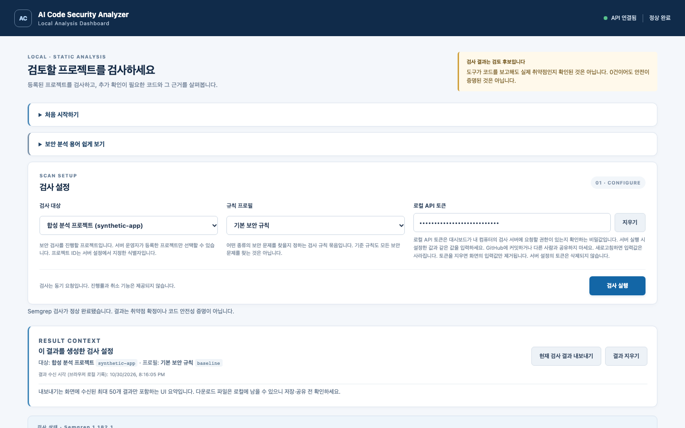
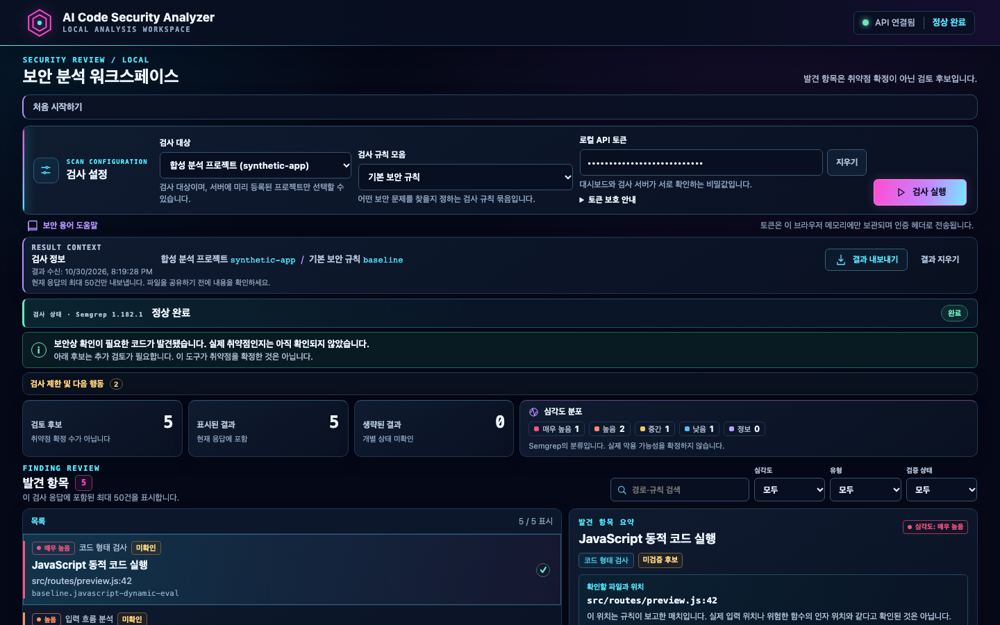

# Phase 36.9A — 사이버펑크 보안 대시보드 리디자인

## 요약

기준 `0caabcc77752016bd3f24b9e75d6388c91fdd16c`에서 React 대시보드를 어두운 네이비 기반의 사이버펑크 분석 워크스페이스로 바꿨다. 결과를 만들지 않는 API·Finding·Evidence 계약과 토큰 처리 방식은 유지했다. 화면 캡처와 브라우저 레이아웃 검증에는 고정된 합성 응답만 사용했다. 표시된 프로젝트·Finding·경로는 실제 저장소 분석 결과가 아니다.

## 시작 Gate와 Baseline

- 현재 브랜치 `main`, 기준 HEAD / `origin/main` / GitHub `main` 일치
- 기준 SHA: `0caabcc77752016bd3f24b9e75d6388c91fdd16c`
- 기준 Actions Run `41040899993`: `push`, `completed`, `success`; 필수 Python, Semgrep, React 및 Chromium E2E job 성공
- 시작 시 working tree clean, ahead/behind 0/0
- Node.js `24.22.2`로 기존 Baseline 실행: Vitest 4개 파일 42개 테스트, typecheck, production build, Playwright browser 3개 테스트 모두 통과
- Playwright Chromium으로 변경 전 화면을 100% zoom, 지정 viewport, 합성 응답으로 캡처했다.

기준 커밋의 통과 결과는 이번 변경이나 새 커밋의 CI 성공을 뜻하지 않는다. 실제 Semgrep E2E는 별도 로컬 회귀로 실행했다.

## 이전 화면에서 확인한 문제

1440×900 기준 기존 화면은 시작 안내, 용어 안내, 검사 설정, 상태 설명과 결과가 세로로 이어져 Finding 목록이 첫 화면에서 보이지 않았다. 같은 합성 데이터를 비교해 재촬영한 뒤 결과 목록과 상세를 좌우로 배치하고, 상태·개요·목록을 앞쪽으로 당겼다. 장식성 문구와 반복 상태 문구를 줄이고, 도구 상태의 코드별 상세는 접을 수 있게 했다.

## 디자인과 정보 구조

- 배경 `#050816`, 표면 `#0b1224` / `#101b32`, 시안 `#54e8ff`, 마젠타 `#ff4bd1`, 바이올렛 `#b493ff`를 기반으로 토큰을 정의했다. 경계, 기본·보조 글자, 성공·경고·오류, 심각도, 모서리, focus ring과 glow도 CSS 변수로 관리한다.
- 헤더는 제품명과 실제 API·검사 상태만 보여준다. 가상의 설정 아이콘, 이전 검사 증가율, 처리 시간 등 존재하지 않는 값은 추가하지 않았다.
- 검사 설정을 가로형 도구 모음으로 정리했다. 대상 선택은 API 목록만 사용하고, 규칙 설명을 쉬운 한국어로 바꿨다. `Experimental` 표기는 유지하며 정확도가 충분히 검증된 규칙이라는 인상을 주지 않는다.
- 결과 영역에는 검사 상태, 보고 후보 수, 표시·생략 수와 심각도 분포를 유지한다. 50건 표시 제한도 표시한다. Finding 목록은 왼쪽, 선택 항목의 요약·매치 위치·확인 작업·제한·접을 수 있는 기술 근거는 오른쪽이다.
- 검색은 API 응답의 규칙 이름/ID, 경로, 줄 번호만 대상으로 한다. 기존 심각도·유형·검증 상태 필터, 선택 동작, 결과 내보내기와 지우기를 유지한다.
- 데스크톱에서는 목록과 상세에 한정된 내부 스크롤을 두고, 모바일에서는 둘을 문서 흐름으로 쌓아 중첩 스크롤을 없앴다. 768px 이하에서 도구 모음과 결과가 세로 배치된다.
- 네온은 주요 상태·선택·행동에만 사용하고, 장식 배경과 과한 애니메이션을 피했다. `prefers-reduced-motion` 설정을 존중한다.

### 쉬운 표현과 근거 의미

- `Finding`은 화면 제목에서 “발견 항목”, `Rule Profile`은 “검사 규칙 모음”, `Technical Details`는 “기술 근거와 제한”으로 안내한다.
- 발견 항목은 미확인 검토 후보로 표시한다. 매치 위치를 Source나 Sink 위치로 부르지 않고, 실제 코드 원문도 추가하지 않았다.
- Source/Sink 선언은 실제 위치 확인을 뜻하지 않고, Trace 부재는 흐름 부재를 뜻하지 않으며, 높은 심각도는 악용 가능성 확정이 아니라는 기존 제한을 유지한다.
- 부분 검사 안내는 누락 가능성과 안전성 판단 불가를 알려준다. 응답에 원인이 없는 경우 구체적 원인을 추측하지 않고, 제공된 정보가 있을 때만 확인하도록 다음 행동 문구를 바꿨다.
- API 오류 코드 설명은 접을 수 있게 했고, 기술 코드는 상세 안에서 보존한다.

## 보안·API 불변성

- FastAPI, API/CLI 계약, Finding/Evidence 구조, Gate/Claim 판단, Semgrep adapter/parser 및 60초/2 MiB 실행 제한은 변경하지 않았다.
- 토큰은 `password` 입력과 React 메모리에만 남으며 `X-Local-API-Token` 헤더로 보낸다. 새로고침 시 사라지고, 지우기는 화면 값만 제거한다. 저장소·세션 저장, URL, 쿠키 또는 로그로 옮기지 않았다.
- 응답 문자열은 React 텍스트로 렌더링하고 `dangerouslySetInnerHTML`을 사용하지 않는다. 실제 코드 원문이나 임의 CWE/OWASP 정보를 만들지 않는다.
- GitHub 입력/수집 기능, 외부 요청, LLM 호출 및 의존성 변경은 없다.

## 오픈소스 참고 및 라이선스

다음 자료에서 상호작용 패턴과 정보 구조를 참고했으며 코드, 템플릿, 이미지 또는 스타일을 복사하지 않았다. UI는 기존 React와 CSS로 구현했고 새 UI 패키지를 추가하지 않았다.

- [shadcn/ui 구성 요소 문서](https://ui.shadcn.com/docs/components) 및 [저장소 MIT 라이선스](https://github.com/shadcn-ui/ui/blob/main/LICENSE.md): 접기, 선택, 버튼, 탐색의 단순 패턴 참고
- [TanStack Table 문서](https://tanstack.com/table/latest/docs/introduction) 및 [저장소 MIT 라이선스](https://github.com/TanStack/table/blob/main/LICENSE): 결과 검색·필터·선택의 사용자 흐름 참고. 라이브러리는 도입하지 않음
- [DefectDojo 저장소](https://github.com/DefectDojo/django-DefectDojo) 및 [BSD 3-Clause 라이선스](https://github.com/DefectDojo/django-DefectDojo/blob/master/LICENSE.md): 발견 항목 우선 검토와 상세의 정보 계층 참고

## 전후 캡처 및 시각 검수

변경 전후 파일은 모두 Chromium, zoom 100%, 동일한 viewport 및 같은 합성 API 응답을 사용했다. 다음 응답은 **합성 mock**이며 실제 Semgrep 실행 결과가 아니다. 각 Finding은 unverified이고, Source/Sink/Trace 정보는 제한된 상태다. 캡처의 토큰은 테스트 전용 값이며 password 입력으로 마스킹되어 있다.

### 1440×900 — 동일 viewport 비교

| 변경 전 | 변경 후 |
| --- | --- |
|  |  |

### 기타 검수 캡처

| 화면 | 변경 전 | 변경 후 |
| --- | --- | --- |
| 1920×1080 완료 | [캡처](assets/ui-cyberpunk-redesign-36-9a/before/completed-1920x1080.png) | [캡처](assets/ui-cyberpunk-redesign-36-9a/after/completed-1920x1080.png) |
| 1280×800 완료 | [캡처](assets/ui-cyberpunk-redesign-36-9a/before/completed-1280x800.png) | [캡처](assets/ui-cyberpunk-redesign-36-9a/after/completed-1280x800.png) |
| 390×844 완료 | [캡처](assets/ui-cyberpunk-redesign-36-9a/before/completed-390x844.png) | [캡처](assets/ui-cyberpunk-redesign-36-9a/after/completed-390x844.png) |
| 심각도 필터 | [캡처](assets/ui-cyberpunk-redesign-36-9a/before/filtered-high.png) | [캡처](assets/ui-cyberpunk-redesign-36-9a/after/filtered-high.png) |
| 선택한 상세 | [캡처](assets/ui-cyberpunk-redesign-36-9a/before/finding-detail.png) | [캡처](assets/ui-cyberpunk-redesign-36-9a/after/finding-detail.png) |
| Finding 0건 + 부분 검사 | — | [1440×900 화면](assets/ui-cyberpunk-redesign-36-9a/after/partial-zero-1440x900.png), [390×844 화면](assets/ui-cyberpunk-redesign-36-9a/after/partial-zero-390x844.png) |

1440×900 전후 캡처를 비교해, 변경 후 첫 화면에서 상태 요약과 Finding 목록·상세 시작 부분을 함께 볼 수 있음을 확인했다. 데스크톱 내부 패널은 추가 항목을 스크롤한다. 390×844에서는 설정 후 결과까지 페이지 스크롤이 남으며, 결과 누락 없이 작은 화면에 세로로 배치한다.

## 접근성 검증

- 주요 입력은 연결된 label과 명확한 accessible name을 가진다. 버튼·입력·선택·접기 요소에 보이는 focus ring을 제공하고, 선택 행은 `aria-pressed`를 사용한다.
- 오류는 `role=alert`, 검사 상태는 `aria-live`가 있는 `role=status`로 전달한다. 색상만으로 심각도/상태를 구분하지 않고 텍스트와 아이콘을 함께 제공한다.
- CSS 주요 글자색을 표면 `#0b1224`와 비교한 대비 계산은 기본 텍스트 16.96:1, 보조 텍스트 10.42:1, 흐린 보조 텍스트 7.38:1, 시안 12.75:1, 경고 13.11:1, 심각도 색상 5.96:1 이상이었다. 이는 대표 토큰의 정적 계산이며 모든 반투명 패널 조합에 대한 공식 WCAG 인증은 아니다.
- axe는 설치되어 있지 않아 추가하지 않았다. 자동 axe 감사는 `NOT_TESTED`; 키보드 이동, 라벨, 상태 알림, 포커스 표시, 텍스트 대비와 viewport overflow는 수동·브라우저 검증했다.

## 테스트 및 시각 검수 결과

- `mise exec node@24 -- npm run typecheck`: 통과
- `mise exec node@24 -- npm test`: 4개 파일, 42개 테스트 통과
- `mise exec node@24 -- npm run build`: 통과
- `mise exec node@24 -- npm run test:browser`: 4개 Chromium 테스트 통과. 320px 키보드 동작 및 1920×1080, 1440×900, 1280×800, 768×1024, 390×844 가로 넘침·첫 화면 위치·글자 크기 확인 포함
- `SEMGREP_REQUIRED=1 mise exec node@24 -- npm run test:e2e:real`: 기존 실제 Chromium–FastAPI–Semgrep E2E 1개 통과. 합성 프로젝트만 사용
- 시각 검수: 기준 1440×900 변경 전후, 1280×800, 390×844, Finding 상세, 필터와 부분 검사/0건 캡처를 직접 확인했다. 최초 캡처에서 주 버튼 hover가 네온 강조를 덮는 문제를 발견해 CSS 수정 후 재캡처했다.
- Python 테스트는 Production 코드 변경이 없어 실행하지 않음 (`NOT_TESTED`).

## 남은 제한

- axe 자동 검사와 화면 확대율별 수동 검수는 미실행
- 실제 사용자 수용 테스트는 진행하지 않았으며, 자동 테스트 성공을 사용자 이해도 승인으로 해석하지 않음
- 작은 화면은 수직 페이지 스크롤이 필요함
- 기준 Run은 시작 SHA에 대한 결과다. 이번 로컬 변경 SHA에는 원격 CI 성공 결과가 없다.

## 판정

`PHASE_36_9A_CYBERPUNK_UI_ACCEPTANCE_READY`

이는 코드·자동 테스트·합성 화면 시각 검수를 완료했다는 뜻이다. 실제 사용자의 이해도 검증이나 새 커밋의 원격 CI 완료를 의미하지 않는다.
